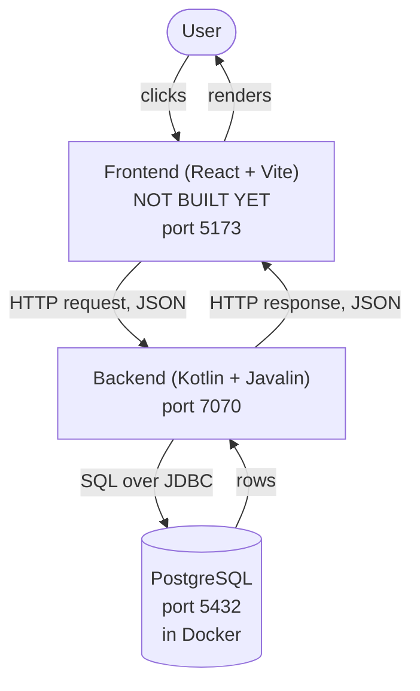
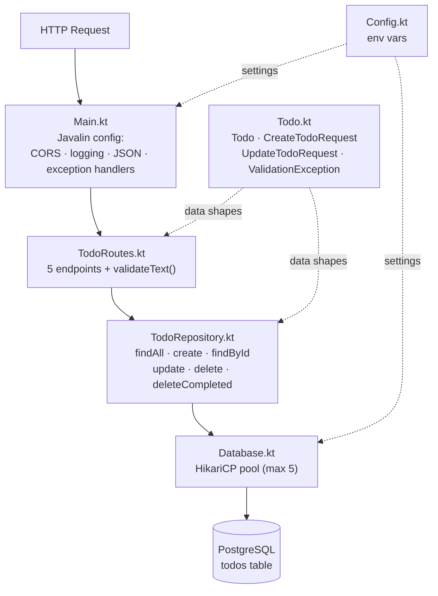
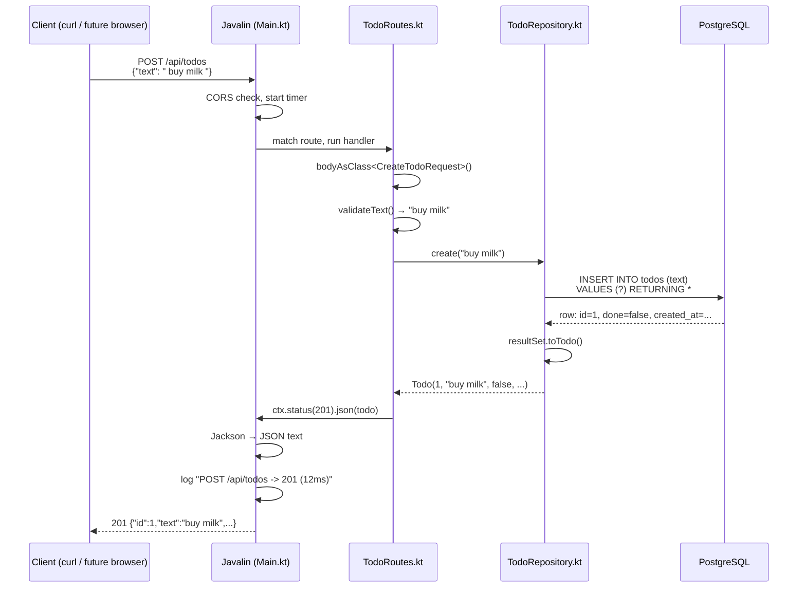
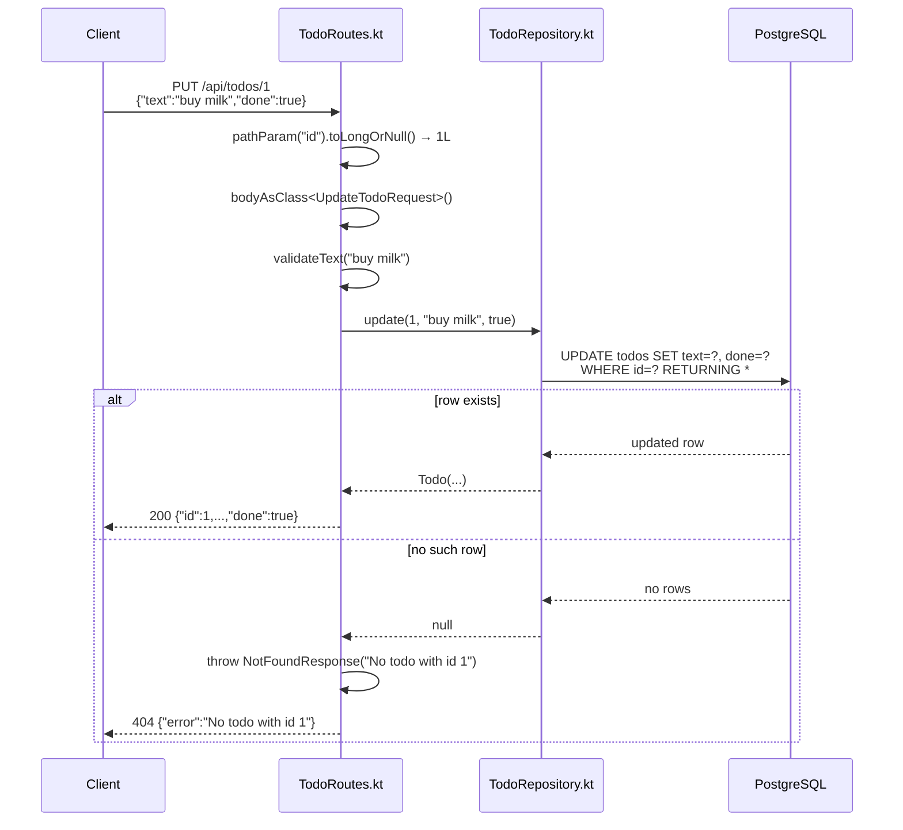
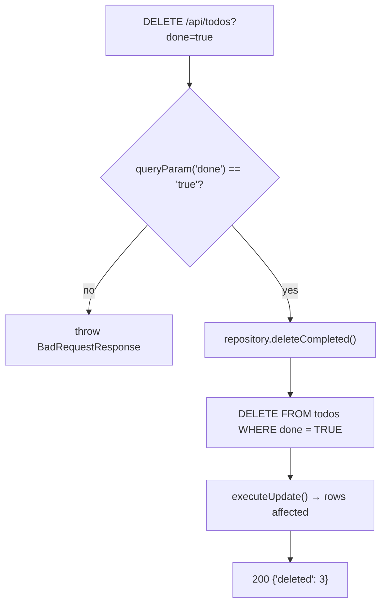
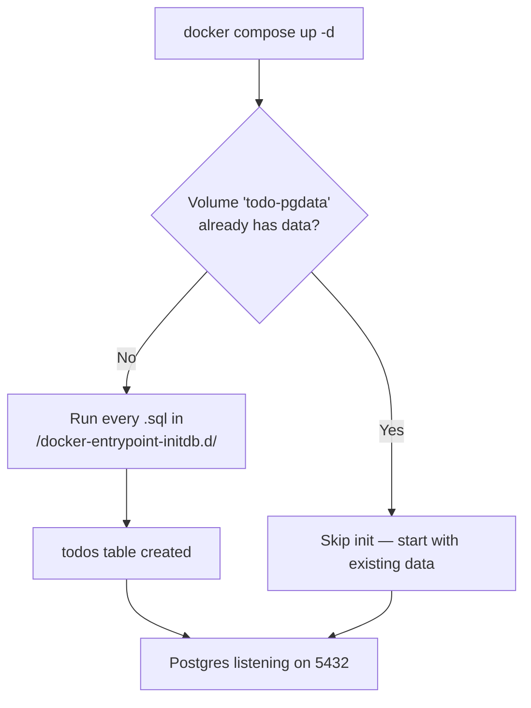
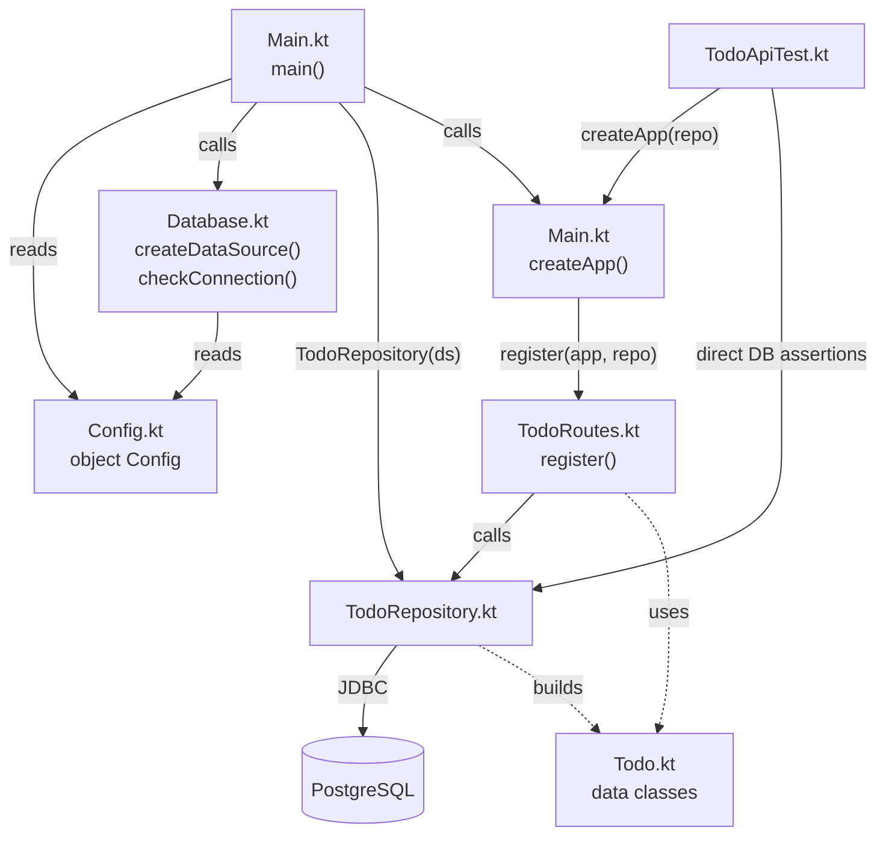
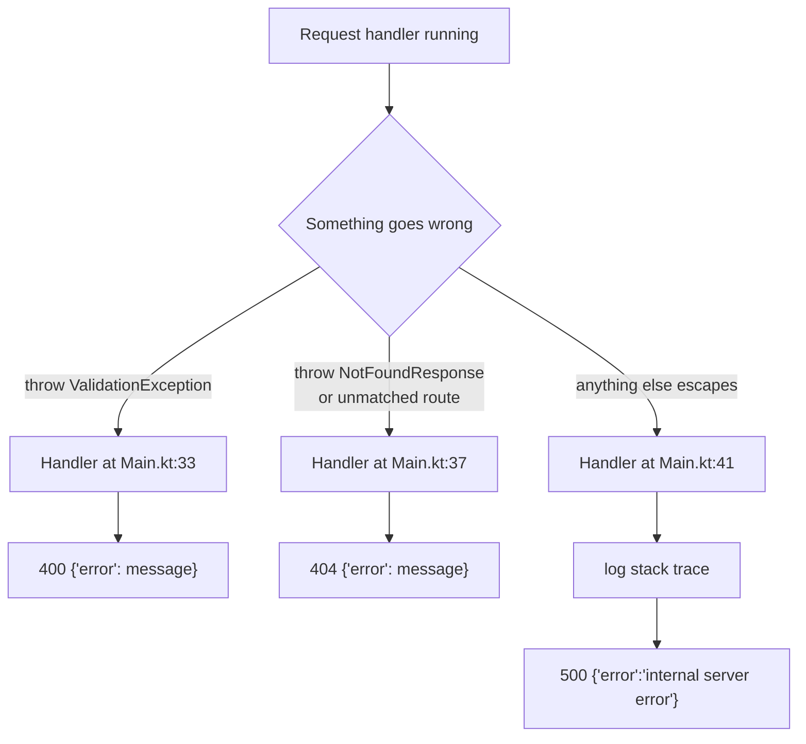
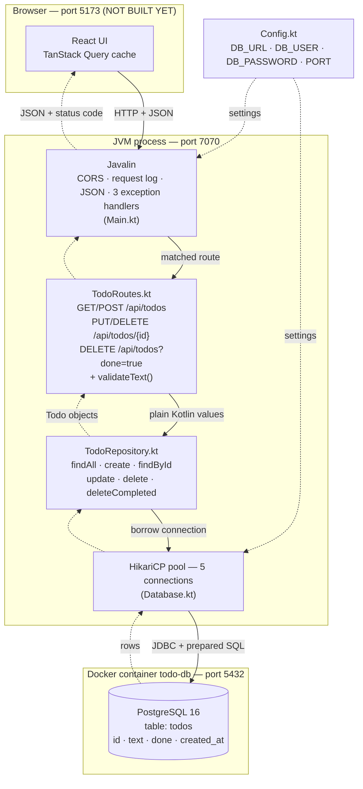

# CODEBASE_GUIDE.md

A beginner's guide to understanding this todo-list application.

> **Read this first:** This guide describes the project **as it exists today**. The most important thing to know up front is that **the frontend has not been built yet.** The `client/` folder contains a single empty placeholder file. Everything that currently *runs* is the backend and the database.
>
> Wherever this guide talks about the frontend, it is either describing the **static design mockup** in `ui-design/` or explaining the **contract the backend has already prepared** for a future frontend. Those parts are clearly labeled.

---

## Table of Contents

1. [The Big Picture](#1-the-big-picture)
2. [Technology Stack](#2-technology-stack)
3. [Project Structure](#3-project-structure)
4. [Application Entry Points](#4-application-entry-points)
5. [Architecture](#5-architecture)
6. [Request Lifecycle](#6-request-lifecycle)
7. [Frontend Deep Dive](#7-frontend-deep-dive)
8. [Backend Deep Dive](#8-backend-deep-dive)
9. [Database Deep Dive](#9-database-deep-dive)
10. [API Guide](#10-api-guide)
11. [Important Concepts](#11-important-concepts-i-need-to-understand)
12. [Code Relationships](#12-code-relationships)
13. [Configuration](#13-configuration)
14. [Error Handling](#14-error-handling)
15. [Running the Application](#15-running-the-application)
16. [Follow the Data](#16-follow-the-data)
17. [What Should I Read First?](#17-what-should-i-read-first)
18. [Beginner Translation](#18-beginner-translation)
19. [Important "Why" Questions](#19-important-why-questions)
20. [Common Beginner Confusions](#20-common-beginner-confusions)
21. [Glossary](#21-glossary)
22. [Final Mental Model](#22-final-mental-model)
23. [Observations](#23-observations-things-worth-knowing-not-changed)

---

## 1. The Big Picture

### What this application does

It's a todo list. A person can:

- see their list of tasks
- add a task
- edit a task's text, or mark it done / not done
- delete one task
- delete all completed tasks at once

That's the whole feature set. Small on purpose — this is a learning project.

### The three pieces

The app is split into three separate programs that talk to each other:

| Piece | What it is | Where it lives | Status |
|---|---|---|---|
| **Frontend** | The web page a person looks at and clicks | `client/` | **Not built yet** |
| **Backend** | A program that answers questions about todos | `server/` | Working |
| **Database** | Where the todos are actually stored on disk | PostgreSQL in Docker | Working |

Why split them at all? Because each one has a different job and runs in a different place:

- The **frontend** runs *in the person's web browser*. It knows how things look.
- The **backend** runs *on a server* (right now, your laptop). It knows the rules.
- The **database** runs *somewhere the backend can reach*. It remembers things after everything shuts down.

### The mental model

Think of it like ordering at a restaurant:

- You (the **user**) read the menu and point at what you want.
- The **waiter** (the frontend) writes it down and walks it to the kitchen.
- The **kitchen** (the backend) decides whether the order is valid, prepares it, and hands back a plate.
- The **pantry** (the database) is where the actual ingredients are stored.

You never walk into the pantry yourself. That's deliberate — there are rules about what's allowed, and the kitchen enforces them.

### The flow

```text
User
  ↓ clicks a button
Frontend (browser)
  ↓ HTTP request  e.g. POST /api/todos  {"text": "buy milk"}
Backend API (Javalin, port 7070)
  ↓ parses, validates
Repository (TodoRepository)
  ↓ SQL  INSERT INTO todos ...
Database (PostgreSQL, port 5432)
  ↓ returns the saved row
Repository turns the row into a Todo object
  ↓
Backend serializes it to JSON
  ↓ HTTP response  201  {"id":1,"text":"buy milk",...}
Frontend updates what's on screen
  ↓
User sees the new task
```



Every box in that diagram is a **separate process** — a separate running program. They find each other by **port number**: a numbered door on your machine. The backend listens on 7070, Postgres on 5432, and the future frontend dev server on 5173.

---

## 2. Technology Stack

Every one of these is declared in a real file in this project. The "Where it's declared" column tells you where to look.

| Technology | What it is | What it does **in this project** | Why it's needed | Where it's declared |
|---|---|---|---|---|
| **Kotlin 2.3** | A programming language that runs on the Java Virtual Machine | The language every backend file is written in — `Main.kt`, `TodoRoutes.kt`, `TodoRepository.kt`, etc. | The backend needs to be written in *something*. Kotlin is less verbose than Java and has built-in null safety (`Todo?` means "a Todo or nothing"), which this code uses heavily. | `server/build.gradle.kts` |
| **JDK 25** | The Java runtime — the thing that actually executes compiled Kotlin | Runs the whole backend | Kotlin compiles down to Java bytecode; the JVM is what executes it | `jvmToolchain(25)` in `build.gradle.kts` |
| **Gradle** | A build tool and package manager | Downloads every library below, compiles the Kotlin, runs the app (`./gradlew run`) and the tests (`./gradlew test`) | You don't want to manually download and wire together six libraries. Gradle reads the dependency list and does it. | `server/build.gradle.kts`, `server/gradlew` |
| **Javalin 6.7** | A small web framework | **This is the HTTP server.** It opens port 7070, listens for requests, matches a URL like `GET /api/todos` to the right block of Kotlin code, and sends the response back. | Writing raw HTTP-over-TCP by hand is enormous. Javalin handles that so the code can just say "when a GET comes in at this path, run this." | `io.javalin:javalin:6.7.0` |
| **Jackson** (+ `jackson-module-kotlin`, `jackson-datatype-jsr310`) | A JSON library | Converts Kotlin objects → JSON text (going out) and JSON text → Kotlin objects (coming in). `jackson-module-kotlin` teaches it about Kotlin data classes; `jsr310` teaches it about dates. | HTTP only carries text. Kotlin works with objects. Something has to translate between them. | `com.fasterxml.jackson.*` |
| **HikariCP 6.2** | A connection pool | Keeps a small set (5) of open connections to Postgres ready to reuse | Opening a database connection is slow — tens of milliseconds. Doing it on every request wastes that repeatedly. A pool opens them once and lends them out. | `com.zaxxer:HikariCP:6.2.1` |
| **PostgreSQL JDBC driver** | The translator between Java/Kotlin and Postgres | Lets `TodoRepository` send SQL strings to Postgres and read results back | The JVM has a standard database interface (JDBC), but every database needs its own driver implementing it | `org.postgresql:postgresql:42.7.4` |
| **PostgreSQL 16** | A relational database | Stores the `todos` table. This is the only thing that survives a restart. | Objects in memory disappear when the program stops. A database doesn't. | `docker-compose.yml` |
| **Docker Compose** | A tool that runs pre-packaged programs in isolated containers | Runs PostgreSQL with one command, pre-configured with the right database name, user, password, and schema | Installing and configuring Postgres by hand on your machine is fiddly and hard to reproduce. A container is disposable and identical every time. | `docker-compose.yml` |
| **SLF4J Simple** | A logging library | Prints log lines to the terminal — request logs, and stack traces when something crashes | Javalin logs through SLF4J but doesn't bundle an implementation. Without this dependency, **Javalin logs nothing at all** and you're debugging blind. | `org.slf4j:slf4j-simple:2.0.17` |
| **JUnit 5** | A testing framework | Finds and runs the four tests in `TodoApiTest.kt`, reports pass/fail | Manual clicking doesn't scale and doesn't catch things you break by accident | `org.junit:junit-bom:5.11.4` |
| **javalin-testtools** | A testing helper for Javalin | `JavalinTest.test(app) { _, client -> ... }` starts the real app on a random free port, hands you an HTTP client, then shuts it down | Lets tests exercise the app through real HTTP instead of calling functions directly, so routing, JSON, and error handling all get tested too | `io.javalin:javalin-testtools:6.7.0` |

**Planned but not yet present** (from `README.md` and `PROJECT-BRAIN.md`): React 19, TypeScript, Vite, Tailwind CSS v4, TanStack Query. None of these are installed — there is no `client/package.json`.

---

## 3. Project Structure

```text
todo-list-app/
├── README.md                     Short project overview (has unfinished TODO sections)
├── PROJECT-BRAIN.md              Detailed running log: what's done, what's next, what was learned
├── CLAUDE.md                     Instructions for AI assistants working on this repo
├── .gitignore                    Files git should never track
├── docker-compose.yml            Defines the PostgreSQL container
├── schema.sql                    The database table definition — runs once on first DB boot
│
├── ui-design/
│   └── todo-app.html             Static visual mockup. NOT part of the running app.
│
├── client/                       FRONTEND — currently EMPTY (only .gitkeep)
│
└── server/                       BACKEND — the working part
    ├── build.gradle.kts          Dependency list + build configuration
    ├── settings.gradle.kts       Names the Gradle project
    ├── gradlew / gradlew.bat     The Gradle wrapper scripts
    ├── gradle/wrapper/           Pins the exact Gradle version (9.7.1)
    └── src/
        ├── main/kotlin/          The application code
        │   ├── Main.kt           Entry point. Builds and starts the server.
        │   ├── Config.kt         Reads settings from environment variables
        │   ├── Database.kt       Creates the connection pool
        │   ├── Todo.kt           Data shapes: Todo, request DTOs, ValidationException
        │   ├── TodoRoutes.kt     The five API endpoints + input validation
        │   └── TodoRepository.kt All the SQL
        └── test/kotlin/
            └── TodoApiTest.kt    Four tests against the real app
```

### What each important folder is responsible for

**`server/src/main/kotlin/`** — the entire backend. Six files, no packages (every file is at the root of the source directory, which is why there are no `package` declarations and no imports between them — in Kotlin, files in the same package see each other automatically).

**`server/src/test/kotlin/`** — a *separate* compilation unit. Test code can see application code; application code can never see test code. That separation is what `testImplementation` vs `implementation` in `build.gradle.kts` sets up.

**`client/`** — reserved. Nothing here yet.

**`ui-design/todo-app.html`** — a self-contained HTML file produced by a design tool. It is *not* wired into the app in any way; nothing serves it, nothing imports it. It exists so the future React frontend has a visual target.

**Root files** — `docker-compose.yml` and `schema.sql` are at the root because they describe the database, which belongs to the whole project rather than to the backend specifically.

---

## 4. Application Entry Points

### What "entry point" means

When you run a program, execution has to start *somewhere* — one specific function that runs first. That's the entry point.

### The backend entry point: `server/src/main/kotlin/Main.kt`

Two things tell the JVM this is the starting point:

```kotlin
// server/build.gradle.kts
application {
    mainClass.set("MainKt")
}
```

`MainKt` is the class the Kotlin compiler generates for the file `Main.kt`. So: "when you run this project, start at the `main()` function in `Main.kt`."

Here is `main()` in full — it's only 15 lines:

```kotlin
// server/src/main/kotlin/Main.kt:55
fun main() {
    val dataSource = try {
        val ds = createDataSource()      // 1. build the connection pool
        checkConnection(ds)              // 2. prove the DB actually answers
        ds
    } catch (e: Exception) {
        System.err.println("FATAL: could not connect to database")
        System.err.println(" URL: ${Config.dbUrl}")
        // ...more diagnostics...
        exitProcess(1)                   // 3. refuse to start
    }

    createApp(TodoRepository(dataSource)).start(Config.port)   // 4. build + start
}
```

**Step by step, in plain English:**

1. **`createDataSource()`** (in `Database.kt`) builds a HikariCP connection pool using the URL, username and password from `Config`. Note it does *not* connect yet — a pool is lazy.

2. **`checkConnection(ds)`** forces the issue: it grabs a connection and runs `SELECT 1`, the smallest possible query. If Postgres isn't running, this throws.

3. **If it throws**, the app prints which URL and user it tried, the underlying cause, a hint (`Is Postgres running? Try: docker compose up -d`), and then `exitProcess(1)` — quit immediately with an error code.

   This is called **failing fast**, and it's a deliberate choice. The alternative would be to start anyway and let every single request fail confusingly with a 500. Better to refuse to start and say exactly why.

4. **`createApp(TodoRepository(dataSource)).start(Config.port)`** does three things in one line, reading inside-out:
   - `TodoRepository(dataSource)` — create the object that knows how to talk to the database, handing it the pool
   - `createApp(...)` — build the fully configured Javalin server (but don't start it)
   - `.start(Config.port)` — open port 7070 and begin listening

### How the app gets built: `createApp()`

```kotlin
// server/src/main/kotlin/Main.kt:18
fun createApp(repository: TodoRepository): Javalin {
    val app = Javalin.create { config ->
        config.jsonMapper(JavalinJackson(objectMapper))       // how to do JSON
        config.bundledPlugins.enableCors { ... }              // browser permission
        config.requestLogger.http { ctx, ms -> ... }          // log every request
    }

    app.exception(ValidationException::class.java) { ... }    // error handlers
    app.exception(NotFoundResponse::class.java) { ... }
    app.exception(Exception::class.java) { ... }

    app.get("/health") { ctx -> ctx.json(mapOf("status" to "ok")) }

    TodoRoutes.register(app, repository)                      // the real endpoints

    return app                                                // NOT started
}
```

**Why is this split out from `main()`?** Because of the tests. `JavalinTest.test(...)` needs to start the app itself, on a random free port, and shut it down afterwards. If `createApp` also called `.start()`, the tests couldn't control that. So:

- `createApp()` = "build and configure the server" — used by both `main()` and the tests
- `.start(port)` = "actually open the port" — only `main()` does this

This is a small, very common refactor, and it's the reason the test file can do `JavalinTest.test(createApp(repository))`.

### How configuration is loaded: `Config.kt`

```kotlin
// server/src/main/kotlin/Config.kt
object Config {
    val dbUrl: String = System.getenv("DB_URL")
        ?: "jdbc:postgresql://localhost:5432/todo"
    val dbUser: String = System.getenv("DB_USER") ?: "todo"
    val dbPassword: String = System.getenv("DB_PASSWORD") ?: "todo"
    val port: Int = System.getenv("PORT")?.toIntOrNull() ?: 7070
}
```

Three pieces of Kotlin syntax worth knowing here:

- **`object Config`** — this declares a *singleton*: exactly one instance exists, created automatically, and you use it by name (`Config.port`). You never write `Config()`. It's Kotlin's way of saying "a bag of global values."
- **`System.getenv("DB_URL")`** — reads an **environment variable**: a named value set outside the program, in the shell or by Docker. Returns `null` if it isn't set.
- **`?: "default"`** — the **elvis operator**. "Use the thing on the left; if it's `null`, use the thing on the right." (It's called elvis because `?:` sideways looks like a quiff.)

So the rule is: *environment variable if present, sensible local default otherwise.* That's why you can run the backend on your laptop with zero setup, but could still point it at a different database later without touching the code.

### The frontend entry point

**There isn't one yet.** When Vite is scaffolded, this section will describe `client/index.html` → `client/src/main.tsx` → `App.tsx`. Today, `client/` holds only `.gitkeep` (an empty file whose only purpose is to make git track an otherwise-empty folder).

### The database entry point

The database doesn't have an entry point in the same sense, but it does have a one-time initialization:

```yaml
# docker-compose.yml
volumes:
  - ./schema.sql:/docker-entrypoint-initdb.d/schema.sql:ro
```

This mounts `schema.sql` into a special folder inside the Postgres container. The official Postgres image runs every `.sql` file in that folder **once, on the very first startup of an empty data volume.** That's how the `todos` table comes into existence without anyone running it manually.

> **Important consequence:** if you edit `schema.sql` later, nothing happens on restart — the volume already exists. You have to destroy the volume (`docker compose down -v`) and start fresh.

---

## 5. Architecture

This project uses a **layered architecture**. Each layer has one job and only talks to the layer directly below it.

```text
    HTTP request from a browser or curl
                  ↓
    ┌─────────────────────────────┐
    │  Javalin (the web server)   │  Main.kt — createApp()
    │  CORS, logging, JSON, errors│
    └─────────────────────────────┘
                  ↓
    ┌─────────────────────────────┐
    │  Routes / Handlers          │  TodoRoutes.kt
    │  parse URL + body, validate │
    └─────────────────────────────┘
                  ↓
    ┌─────────────────────────────┐
    │  Repository                 │  TodoRepository.kt
    │  all SQL lives here         │
    └─────────────────────────────┘
                  ↓
    ┌─────────────────────────────┐
    │  Connection Pool (Hikari)   │  Database.kt
    └─────────────────────────────┘
                  ↓
              PostgreSQL
```



### What each layer is responsible for

**Javalin config (`Main.kt`)** — cross-cutting concerns. Things that apply to *every* request regardless of which endpoint it hits: how to convert JSON, which browser origins are allowed, logging, and what to do when an exception escapes.

*Should NOT contain:* business rules or SQL.

**Routes (`TodoRoutes.kt`)** — the translation layer between HTTP and Kotlin. It reads the URL path, reads the request body, checks the input is acceptable, calls exactly one repository method, and decides the status code.

*Should NOT contain:* SQL, or knowledge of how todos are stored.

Notice how thin the handlers are:

```kotlin
app.get("/api/todos") { ctx ->
    ctx.json(repository.findAll())
}
```

That's the whole GET endpoint. One line. That's the goal.

**Repository (`TodoRepository.kt`)** — the only file in the project that contains SQL. It takes plain Kotlin values in (`create(text: String)`) and gives plain Kotlin objects back (`Todo`). It knows nothing about HTTP — no status codes, no request objects, no `ctx`.

*Should NOT contain:* HTTP concepts or validation rules.

**Models (`Todo.kt`)** — pure data shapes with no behavior. Shared by the layers above.

### Is there a service layer?

**No, and that's intentional.** A lot of backends have a "service" layer between routes and repository for business logic. This app doesn't, because there's barely any business logic — the only rule is "text must be non-blank and at most 500 characters," which lives as a private function in `TodoRoutes.kt`:

```kotlin
private fun validateText(text: String): String
```

If the rules got more complicated (say, todos belonged to users and you needed permission checks), a service layer would earn its place. Right now it would be an empty box that just forwards calls. **Don't add layers before you need them** — but do recognise that `validateText` is business logic sitting in the routing layer, which is the pragmatic compromise here.

### Why layer it at all?

Three concrete benefits, all visible in this codebase:

1. **You know where to look.** Something wrong with the SQL? `TodoRepository.kt`. Wrong status code? `TodoRoutes.kt`. It's never "somewhere in a 400-line file."
2. **You can swap a layer.** Every repository method takes and returns plain Kotlin. If you replaced raw JDBC with an ORM tomorrow, `TodoRoutes.kt` would not change by one character.
3. **You can test in isolation.** The tests pass a repository *into* `createApp()`. That's the seam that makes testing possible.

---

## 6. Request Lifecycle

This is the most important section. Let's trace three real requests end to end through the actual code.

> Since there is no frontend yet, the "frontend" steps below describe what a browser *would* send. The backend steps are all real and traced through the actual files.

---

### Flow A: Creating a todo — `POST /api/todos`



**Step 1 — The request arrives.**
A browser or curl sends raw text over TCP to port 7070:

```http
POST /api/todos HTTP/1.1
Host: localhost:7070
Content-Type: application/json

{"text": "  buy milk  "}
```

**Step 2 — Javalin receives it.**
*File:* `Main.kt` (the configuration built in `createApp`).
Javalin (running on an embedded Jetty web server) accepts the connection, parses the HTTP text into a `Context` object — usually called `ctx` — which holds everything about this request and the response being built.

The CORS plugin checks the `Origin` header. If it's `http://localhost:5173`, an `Access-Control-Allow-Origin` header gets added to the response. If it's anything else, the header is simply left out.

**Step 3 — Route matching.**
*File:* `TodoRoutes.kt:12`
Javalin compares method + path against its registered routes and finds:

```kotlin
app.post("/api/todos") { ctx -> ... }
```

The `{ ctx -> ... }` part is a **lambda** — an unnamed function stored for later. `app.post(path) { ... }` doesn't run that code; it *files it away* under "POST /api/todos." Javalin runs it now, handing it the `ctx`.

**Step 4 — Parsing the body.**

```kotlin
val request = ctx.bodyAsClass<CreateTodoRequest>()
```

**In plain English:** "Take the JSON text the client sent, and turn it into a `CreateTodoRequest` object."

Behind the scenes, Javalin hands the raw body text to Jackson (the JSON mapper configured back in `Main.kt`). Jackson looks at `CreateTodoRequest`, sees it needs a `text: String`, finds `"text"` in the JSON, and constructs the object. Now the code has `request.text` — a normal Kotlin property — instead of having to dig through raw text.

The `<CreateTodoRequest>` in angle brackets is a **generic type argument**: it's how you tell a function *what type* you want back.

**Step 5 — Validation.**
*File:* `TodoRoutes.kt:46`

```kotlin
private fun validateText(text: String): String {
    val trimmed = text.trim()
    if (trimmed.isBlank()) throw ValidationException("Text must not be blank")
    if (trimmed.length > MAX_TEXT_LENGTH) throw ValidationException("...")
    return trimmed
}
```

Two things happen here, and the second is easy to miss: it **validates *and* cleans**. It returns the *trimmed* string, and that return value is what gets saved. So `"  buy milk  "` is stored as `"buy milk"`.

If validation fails, it throws — and execution stops dead. See [Error Handling](#14-error-handling) for where control goes next.

**Step 6 — Calling the repository.**

```kotlin
val todo = repository.create(validateText(request.text))
```

Reading inside-out: get the text → validate/trim it → pass the clean string to the repository. The route hands over a plain `String`. It doesn't know or care that a database is involved.

**Step 7 — The SQL.**
*File:* `TodoRepository.kt:20`

```kotlin
fun create(text: String): Todo {
    return dataSource.connection.use { connection ->
        connection.prepareStatement("INSERT INTO todos (text) VALUES (?) RETURNING *").use { statement ->
            statement.setString(1, text)
            statement.executeQuery().use { resultSet ->
                resultSet.next()
                resultSet.toTodo()
            }
        }
    }
}
```

Piece by piece:

- **`dataSource.connection`** — borrow a connection from the Hikari pool.
- **`.use { ... }`** — Kotlin's "try-with-resources." Run this block, then **guarantee** the resource is closed afterwards, even if an exception is thrown. For a pooled connection, "closed" means *returned to the pool*, not actually disconnected. Without `.use`, a failure would leak a connection; after five leaks the pool is empty and the app hangs forever. This is why it appears on every connection, statement, and result set in the file.
- **`prepareStatement("... VALUES (?) ...")`** — a **prepared statement**. The `?` is a placeholder. The SQL structure is sent to Postgres *separately* from the value, so a user typing `'); DROP TABLE todos; --` gets stored as harmless text instead of being executed. This is the defense against **SQL injection**, and it's why you never build SQL by gluing strings together.
- **`statement.setString(1, text)`** — fill placeholder #1. (JDBC counts from 1, not 0.)
- **`RETURNING *`** — a PostgreSQL feature: "after inserting, give me back the complete row you just wrote." That's how the code gets the database-generated `id` and `created_at` without a second query.
- **`resultSet.next()`** — a result set starts positioned *before* the first row. `next()` moves to the first row. You must call it before reading anything.
- **`resultSet.toTodo()`** — convert the raw row into a Kotlin object.

**Step 8 — Row becomes object.**
*File:* `TodoRepository.kt:74`

```kotlin
private fun ResultSet.toTodo(): Todo = Todo(
    id = getLong("id"),
    text = getString("text"),
    done = getBoolean("done"),
    createdAt = getObject("created_at", OffsetDateTime::class.java)
)
```

This is an **extension function** — Kotlin syntax that lets you add a method to a class you don't own. `ResultSet` comes from the Java standard library, but after this declaration you can write `resultSet.toTodo()` as though it were built in. Inside, `this` is the result set, so `getLong("id")` means `this.getLong("id")`.

It's `private`, so it's only usable inside this file — exactly right, because this is the one place that should know about column names. Note this is also where `created_at` (database naming: snake_case) becomes `createdAt` (Kotlin naming: camelCase).

**Step 9 — The response.**

```kotlin
ctx.status(201).json(todo)
```

`201 Created` — not plain `200 OK` — because a new resource was made. `.json(todo)` hands the `Todo` object to Jackson, which produces:

```json
{"id":1,"text":"buy milk","done":false,"createdAt":"2026-09-21T10:15:30.123456+00:00"}
```

The `createdAt` looks like a readable date string rather than a big number because of this line back in `Main.kt`:

```kotlin
.disable(SerializationFeature.WRITE_DATES_AS_TIMESTAMPS)
```

Without it, Jackson writes dates as raw epoch numbers, which JavaScript can't parse directly.

**Step 10 — Logging and return.**
The request logger fires:

```kotlin
config.requestLogger.http { ctx, ms ->
    logger.info("${ctx.method()} ${ctx.path()} -> ${ctx.status()} (${ms.toInt()}ms)")
}
```

printing `POST /api/todos -> 201 (12ms)`, and Javalin writes the HTTP response back over the socket.

---

### Flow B: Toggling a todo done — `PUT /api/todos/1`



The handler:

```kotlin
// TodoRoutes.kt:18
app.put("/api/todos/{id}") { ctx ->
    val id = ctx.pathParam("id").toLongOrNull()
        ?: throw ValidationException("id must be a number")
    val request = ctx.bodyAsClass<UpdateTodoRequest>()
    val todo = repository.update(id, validateText(request.text), request.done)
        ?: throw NotFoundResponse("No todo with id $id")
    ctx.json(todo)
}
```

**The three interesting things here:**

**1. `{id}` in the path is a placeholder.** Registering `"/api/todos/{id}"` tells Javalin to match `/api/todos/1`, `/api/todos/99`, anything. `ctx.pathParam("id")` pulls out whatever was in that slot — always as a `String`, because URLs are text.

**2. `toLongOrNull()` instead of `toLong()`.** `toLong()` *throws* if the text isn't a number. `toLongOrNull()` returns `null`. Choosing the `OrNull` version means *this code* decides what bad input means — a clean 400 with a clear message — rather than letting an exception bubble up and become a confusing 500. **General rule: for anything arriving from outside your program, prefer the `OrNull` form.**

**3. Two different `?:` operators doing two different jobs.**

```kotlin
val id = ctx.pathParam("id").toLongOrNull() ?: throw ValidationException(...)
```
"Parsed a number? Use it. Got null? Throw a 400."

```kotlin
val todo = repository.update(...) ?: throw NotFoundResponse(...)
```
"Repository returned a Todo? Use it. Returned null? Throw a 404."

This is null-safety as control flow. The repository's return type is `Todo?` — "a Todo *or* nothing" — and Kotlin will not let you use it as a `Todo` until you've handled the null case. The compiler enforces that you think about the miss.

**Why does PUT require *both* `text` and `done`?** Look at the DTO:

```kotlin
// Todo.kt
data class UpdateTodoRequest(
    val text: String,      // not String? — required
    val done: Boolean,     // not Boolean? — required
)
```

Neither field is nullable, and `jackson-module-kotlin` respects that: a request missing either field cannot be turned into this object. **The type declaration is itself a form of validation.** The tradeoff: to just tick a checkbox, the client has to send the unchanged text along with the new `done` value. That's a deliberate decision recorded in `PROJECT-BRAIN.md` — simpler than supporting partial updates.

---

### Flow C: Clearing completed todos — `DELETE /api/todos?done=true`

```kotlin
// TodoRoutes.kt:36
app.delete("/api/todos") { ctx ->
    if (ctx.queryParam("done") != "true") {
        throw BadRequestResponse("Expected ?done=true")
    }
    ctx.json(mapOf("deleted" to repository.deleteCompleted()))
}
```



**Query parameter vs path parameter** — this is a common point of confusion:

| | Path parameter | Query parameter |
|---|---|---|
| Looks like | `/api/todos/1` | `/api/todos?done=true` |
| Read with | `ctx.pathParam("id")` | `ctx.queryParam("done")` |
| Means | *which* resource | *how* / *filter* |
| Missing? | Route doesn't match at all | Returns `null` |

**Why the guard?** Without it, a bare `DELETE /api/todos` — a plausible typo — would silently wipe every completed todo. Requiring the explicit `?done=true` makes destructive intent deliberate. This is the one endpoint where a mistake loses data, so it asks you to mean it.

**Why `executeUpdate()` and not `executeQuery()`?**

| | Used for | Returns |
|---|---|---|
| `executeQuery()` | SELECT, or anything with `RETURNING` | A `ResultSet` (rows) |
| `executeUpdate()` | INSERT / UPDATE / DELETE with no `RETURNING` | An `Int` — how many rows changed |

```kotlin
fun deleteCompleted(): Int = ... statement.executeUpdate()
```

That count is exactly what the client wants, so it goes straight into the response. Compare with `delete(id)`:

```kotlin
fun delete(id: Long): Boolean = ... statement.executeUpdate() > 0
```

Same call, but converted to a boolean: "did anything actually get deleted?" — which the route uses to decide 204 vs 404.

---

## 7. Frontend Deep Dive

### Honest status: there is no frontend

`client/` contains exactly one file: `.gitkeep`, which is empty. There is no `package.json`, no `src/`, no React, no Vite config. **Nothing in this project currently renders a user interface.**

I'm stating this plainly rather than describing a planned frontend as though it exists.

### What *does* exist: the design mockup

`ui-design/todo-app.html` is a self-contained HTML file exported from a design tool. It is not React, is not served by anything, and is not imported anywhere. Open it directly in a browser to see the target design.

Reading its embedded template, the intended UI is:

- A dark page (`oklch(0.18 0.006 260)` — very dark blue-grey), content centered, max width 520px, Inter font
- A header: `Tasks`, with a summary line beneath it like `2 of 3 remaining`
- A form: a text input (`Add a task and press Enter`) plus an `Add` button
- An empty state: `No tasks yet. Add your first one above.`
- A list of todo rows, each with a checkbox, the text, and a delete control
- A `Clear completed` button that only appears when at least one todo is done

The mockup uses fake in-memory state — a hardcoded array of two todos and a `nextId` counter. **That's the whole point of a mockup:** it proves the design works without needing a server. The real frontend replaces that fake state with calls to the API.

### What the backend has already prepared for the frontend

Even with no frontend written, the backend has made two commitments to it:

**1. CORS permission** (`Main.kt:22`)

```kotlin
config.bundledPlugins.enableCors { cors ->
    cors.addRule { rule ->
        rule.allowHost("http://localhost:5173")
    }
}
```

`5173` is Vite's default dev server port. See [Concept: CORS](#cors-cross-origin-resource-sharing) for what this actually does — it's more subtle than it looks.

**2. The API contract** — the five endpoints in [Section 10](#10-api-guide), with a consistent JSON error shape.

### The planned frontend architecture (from PROJECT-BRAIN.md — not yet code)

The recorded plan is React 19 + TypeScript + Vite + Tailwind CSS v4 + TanStack Query, with one note that's worth understanding now because it's a genuinely important idea:

> **TanStack Query owns server state. Do not copy todos into `useState` — the cache is the source of truth.**

**What that means:** there's a difference between two kinds of state in a frontend.

| | Client state | Server state |
|---|---|---|
| Example | What you've typed in the input box so far | The list of todos |
| Who owns the truth | The browser | The database |
| Can it go stale? | No | Yes — someone else could change it |
| Tool | React `useState` | TanStack Query |

The trap for beginners: fetching todos and storing them in `useState` means you now have *two* copies of the list — the real one in the database, and a snapshot in the browser — and you're responsible for keeping them in sync by hand. TanStack Query manages that copy as a cache with rules: fetch it, know when it's stale, refetch it, and let you say "that list just changed, throw it away and refetch" (`invalidateQueries`) after a create/update/delete.

Everything else about the frontend is genuinely unknown until it's written.

---

## 8. Backend Deep Dive

### 8.1 — Server initialization

Covered in [Section 4](#4-application-entry-points). The short version: `main()` proves the database works → `createApp()` builds a configured Javalin instance → `.start(7070)` opens the port.

### 8.2 — The Javalin configuration block

```kotlin
val app = Javalin.create { config -> ... }
```

That lambda is a **configuration block** — a common framework pattern. Instead of `Javalin.create(jsonMapper, corsRules, logger, ...)` with a dozen arguments, the framework hands you a mutable `config` object and lets you set only what you care about. Everything you don't touch keeps its default.

Three things are set here:

**JSON mapper:**
```kotlin
config.jsonMapper(JavalinJackson(objectMapper))
```
Where `objectMapper` is built at the top of the file:
```kotlin
private val objectMapper: ObjectMapper = ObjectMapper()
    .registerKotlinModule()                                 // understand Kotlin data classes
    .registerModule(JavaTimeModule())                       // understand OffsetDateTime
    .disable(SerializationFeature.WRITE_DATES_AS_TIMESTAMPS) // write dates as readable strings
```

Each line fixes a specific gap. Jackson is a Java library, so by default it doesn't know that Kotlin data classes have constructor parameters rather than setters (`registerKotlinModule`), doesn't know about the modern Java date types (`JavaTimeModule`), and prefers epoch numbers over ISO-8601 strings (`disable(...)`). Without the first, Jackson can't build a `CreateTodoRequest` at all.

**CORS** — discussed in [Section 11](#cors-cross-origin-resource-sharing).

**Request logger** — runs after each request, receiving the context and how long it took.

### 8.3 — Routes

All five live in `TodoRoutes.kt`:

```kotlin
object TodoRoutes {
    fun register(app: Javalin, repository: TodoRepository) {
        app.get("/api/todos")          { ... }
        app.post("/api/todos")         { ... }
        app.put("/api/todos/{id}")     { ... }
        app.delete("/api/todos/{id}")  { ... }
        app.delete("/api/todos")       { ... }
    }
}
```

**Why is this a separate file rather than inline in `Main.kt`?** Separation of concerns. `Main.kt` handles "how the server behaves in general"; `TodoRoutes.kt` handles "what endpoints exist for todos." If you added a second resource — users, say — it would be `UserRoutes.kt`, and `Main.kt` would gain one line.

**Why does `register` take both `app` and `repository` as parameters?** This is **dependency injection**, done by hand. `TodoRoutes` never creates a repository; it receives one. Consequences:

- `TodoRoutes` doesn't need to know how a repository is built (pool, config, credentials — not its problem)
- A test can pass in a different repository
- There's exactly one repository instance in the whole app, created once in `main()`

No framework, no annotations. Just passing arguments. That's all dependency injection fundamentally is.

### 8.4 — Validation

```kotlin
private const val MAX_TEXT_LENGTH = 500

private fun validateText(text: String): String {
    val trimmed = text.trim()
    if (trimmed.isBlank()) throw ValidationException("Text must not be blank")
    if (trimmed.length > MAX_TEXT_LENGTH) throw ValidationException("Text must be at most $MAX_TEXT_LENGTH characters")
    return trimmed
}
```

Called by both POST and PUT, so both store cleaned text.

**Why validate at all, when `schema.sql` already has `CHECK (length(trim(text)) > 0)`?** Two reasons, both good:

1. **Better errors.** The database check produces a driver-level SQL exception, which would hit the catch-all handler and become a generic 500. The application check produces `400 {"error": "Text must not be blank"}` — which tells the client what it did wrong and that retrying with different input will work.
2. **Defense in depth.** The database constraint is the last line of defense that *cannot* be bypassed, no matter what code talks to it. The application check is the friendly one. You want both.

Note the 500-character cap exists *only* in the application — the database column is unbounded `TEXT`.

### 8.5 — DTOs and models

```kotlin
// Todo.kt
data class Todo(val id: Long, val text: String, val done: Boolean, val createdAt: OffsetDateTime)
data class CreateTodoRequest(val text: String)
data class UpdateTodoRequest(val text: String, val done: Boolean)
class ValidationException(message: String) : RuntimeException(message)
```

**`data class`** is Kotlin shorthand. Writing `data` in front of a class makes the compiler generate `equals()`, `hashCode()`, `toString()`, and `copy()` for you, based on the constructor properties. It signals "this is a bag of values, not a thing with behavior."

**Why three classes instead of one?** Because the shapes genuinely differ:

| | `CreateTodoRequest` | `UpdateTodoRequest` | `Todo` |
|---|---|---|---|
| `id` | ✗ (server assigns it) | ✗ (it's in the URL) | ✓ |
| `text` | ✓ | ✓ | ✓ |
| `done` | ✗ (always starts false) | ✓ | ✓ |
| `createdAt` | ✗ (server assigns it) | ✗ (never changes) | ✓ |

**DTO** = Data Transfer Object: a shape defined for moving data across a boundary. If POST accepted a full `Todo`, a client could try to dictate its own `id` and `createdAt`. By accepting only `CreateTodoRequest`, those fields are *structurally* impossible to send. The type system enforces the API contract.

### 8.6 — The repository

Six methods, one private extension function, and every SQL statement in the project:

| Method | SQL | Returns | Why that return type |
|---|---|---|---|
| `findAll()` | `SELECT * FROM todos ORDER BY created_at` | `List<Todo>` | Zero todos is a valid answer — an empty list, not an error |
| `create(text)` | `INSERT ... RETURNING *` | `Todo` | Always succeeds (or throws) — never null |
| `findById(id)` | `SELECT ... WHERE id = ?` | `Todo?` | Might not exist |
| `update(id, text, done)` | `UPDATE ... RETURNING *` | `Todo?` | Might not exist |
| `delete(id)` | `DELETE ... WHERE id = ?` | `Boolean` | "Did it exist?" is all the caller needs |
| `deleteCompleted()` | `DELETE ... WHERE done = TRUE` | `Int` | The count is the useful answer |

**`ORDER BY created_at`** matters more than it looks. SQL makes **no guarantee** about row order unless you ask. Without `ORDER BY`, the list could come back in a different order on different days, and the UI would appear to shuffle itself. Always order explicitly when order is visible to a user.

**`findById` is currently unused** by any route — see [Observations](#23-observations-things-worth-knowing-not-changed).

### 8.7 — Exception handlers

```kotlin
app.exception(ValidationException::class.java) { e, ctx -> ctx.status(400).json(mapOf("error" to (e.message ?: "invalid request"))) }
app.exception(NotFoundResponse::class.java)   { e, ctx -> ctx.status(404).json(mapOf("error" to (e.message ?: "not found"))) }
app.exception(Exception::class.java)          { e, ctx -> logger.error(...); ctx.status(500).json(mapOf("error" to "internal server error")) }
```

Fully explained in [Section 14](#14-error-handling).

### 8.8 — Tests

`server/src/test/kotlin/TodoApiTest.kt` — four tests, run with `./gradlew test`.

```kotlin
@Test
fun `POST creates a todo and returns it with an id`() {
    JavalinTest.test(createApp(repository)) { _, client ->
        val response = client.post("/api/todos", mapOf("text" to "buy milk"))
        assertEquals(201, response.code)

        val created: Todo = mapper.readValue(response.body!!.string())
        assertEquals("buy milk", created.text)
        assertEquals(false, created.done)

        assertEquals(1, repository.findAll().size)   // ← check the DB too
    }
}
```

Things worth understanding:

- **Backtick function names.** Kotlin lets you write `` fun `POST creates a todo`() `` so the test report reads like English.
- **`JavalinTest.test(app) { _, client -> }`** starts the app on a random free port, runs the block with an HTTP client pointed at it, then shuts it down. The `_` is the app instance, which these tests don't need. *This is why `createApp` must not call `.start()`.*
- **The last assertion checks the database, not the response.** An endpoint can return a convincing `201` while writing nothing. Asserting on both closes that gap.
- **The `companion object`** holds the data source, repository, and mapper. JUnit constructs a **new instance of the test class for every test method**, so a pool declared as a normal property would create one pool per test and leak four of them. A companion object is shared across all instances.
- **`@BeforeEach fun resetDatabase()`** runs `TRUNCATE todos RESTART IDENTITY` before each test — empty the table and reset the id counter to 1 — so tests can't affect each other.

> ⚠️ **These tests use the real development database.** Running `./gradlew test` **deletes all your local todos.** It's a known, accepted tradeoff recorded in `PROJECT-BRAIN.md`; the fix would be a separate `todos_test` database.

Test coverage is deliberately partial: PUT, the bulk delete, and the 500-character cap are untested.

---

## 9. Database Deep Dive

### What a database is (and why not just use a file)

A **relational database** stores data in **tables** — like spreadsheets with strict rules. Each table has named **columns** (fields) and holds **rows** (records). Unlike a file, a database gives you: a query language for asking precise questions, constraints it enforces for you, safe concurrent access from multiple programs at once, and guarantees that a half-finished write never gets left behind.

This project uses **PostgreSQL 16**, running inside Docker.

### The one table

```sql
-- schema.sql
CREATE TABLE IF NOT EXISTS todos (
  id         BIGSERIAL PRIMARY KEY,
  text       TEXT NOT NULL CHECK (length(trim(text)) > 0),
  done       BOOLEAN NOT NULL DEFAULT FALSE,
  created_at TIMESTAMPTZ NOT NULL DEFAULT now()
);
```

Column by column:

| Column | Type | Rules | What it means |
|---|---|---|---|
| `id` | `BIGSERIAL` | `PRIMARY KEY` | A big auto-incrementing whole number. `SERIAL` means "the database assigns the next number automatically" — you never supply it. `PRIMARY KEY` means it uniquely identifies the row and can never be null or duplicated. |
| `text` | `TEXT` | `NOT NULL`, `CHECK (...)` | The task description. `TEXT` is unlimited-length string. `NOT NULL` = must have a value. The `CHECK` refuses any text that's empty once whitespace is trimmed. |
| `done` | `BOOLEAN` | `NOT NULL DEFAULT FALSE` | Ticked or not. `DEFAULT FALSE` means the INSERT doesn't have to mention it — new todos start undone. |
| `created_at` | `TIMESTAMPTZ` | `NOT NULL DEFAULT now()` | When it was created. The `TZ` means **with time zone** — the value carries its UTC offset, so it's unambiguous anywhere in the world. `DEFAULT now()` means the database stamps it. |

**`CREATE TABLE IF NOT EXISTS`** — don't error if it's already there. Makes the script safe to run more than once.

### There are no relationships

One table, no foreign keys, no joins. A **foreign key** is a column pointing at another table's primary key (a `user_id` on `todos` pointing at a `users` table, for instance). This app has no users and no categories, so there's nothing to point at. If you ever add users, that's the first relationship you'd build.

### How the table gets created

There is **no migration tool** (no Flyway, no Liquibase). Instead:

```yaml
# docker-compose.yml
volumes:
  - todo-pgdata:/var/lib/postgresql/data
  - ./schema.sql:/docker-entrypoint-initdb.d/schema.sql:ro
```

The first line is where Postgres keeps its data — a named Docker volume, so the data survives the container being removed. The second mounts `schema.sql` (read-only, `:ro`) into the Postgres image's init folder, where it runs **once, on first boot of an empty data directory.**



> **The trap this creates:** editing `schema.sql` does nothing on a normal restart. To apply a schema change you must destroy the volume:
> ```bash
> docker compose down -v   # -v also deletes the volume — ALL DATA IS LOST
> docker compose up -d
> ```
> This is fine for a learning project. It's not how you'd change a schema in production — that's exactly the problem migration tools solve.

### How the application connects

```kotlin
// Database.kt
fun createDataSource(): HikariDataSource {
    val config = HikariConfig()
    config.jdbcUrl = Config.dbUrl       // jdbc:postgresql://localhost:5432/todo
    config.username = Config.dbUser
    config.password = Config.dbPassword
    config.maximumPoolSize = 5
    return HikariDataSource(config)
}
```

**Reading the JDBC URL** `jdbc:postgresql://localhost:5432/todo`:

| Part | Meaning |
|---|---|
| `jdbc:` | Use the JVM's standard database interface |
| `postgresql:` | Which driver — tells the JVM to load the Postgres one |
| `//localhost:5432` | Which machine and port |
| `/todo` | Which database on that server |

**Why a connection pool?** Opening a TCP connection, authenticating, and setting up a database session takes tens of milliseconds. Doing that per request would dominate your response times. A pool opens five connections up front and lends them out: borrow → use → return. `maximumPoolSize = 5` is plenty for local development.

### How queries are executed

Every repository method follows the same four-step shape:

```kotlin
dataSource.connection.use { connection ->                    // 1. borrow
    connection.prepareStatement("SQL WITH ? ?").use { st ->   // 2. prepare
        st.setString(1, value)                                // 3. fill placeholders
        st.executeQuery().use { rs -> rs.toTodo() }           // 4. run & read
    }
}
```

Three nested `.use { }` blocks, closing in reverse order. It's repetitive — and that repetition is precisely what an ORM (a library that maps objects to tables automatically) removes. This project deliberately skips the ORM so the mechanics stay visible. That's a *learning* choice, not a performance one.

### How rows become objects

```text
Database row:     id=1 | text='buy milk' | done=f | created_at=2026-09-21 10:15:30+00
                            ↓  ResultSet.toTodo()
Kotlin object:    Todo(id=1L, text="buy milk", done=false, createdAt=2026-09-21T10:15:30Z)
                            ↓  Jackson
JSON:             {"id":1,"text":"buy milk","done":false,"createdAt":"2026-09-21T10:15:30Z"}
```

Same information, three different shapes, one for each layer that needs it. Note the naming change at the first arrow: `created_at` → `createdAt`. SQL conventionally uses snake_case; Kotlin and JSON use camelCase. `toTodo()` is where that translation happens, and it's the only place in the codebase that knows the database's column names.

---

## 10. API Guide

**Base URL (local):** `http://localhost:7070`

All request and response bodies are JSON. Every error response has the same shape: `{"error": "<message>"}`.

---

### `GET /health`

**Purpose:** Confirm the server is up. Not part of the todo API — it's a *health check*, the standard way for you (or a monitoring tool, or a load balancer) to ask "are you alive?"

**Request:** none

**Response:** `200`
```json
{"status": "ok"}
```

**Internally:** `Main.kt:46` → `ctx.json(...)`. Doesn't touch the database.

---

### `GET /api/todos`

**Purpose:** Fetch every todo, oldest first.

**Request:** none

**Response:** `200`
```json
[
  {"id":1,"text":"buy milk","done":false,"createdAt":"2026-09-21T10:15:30.123456+00:00"},
  {"id":2,"text":"walk dog","done":true, "createdAt":"2026-09-21T10:16:00.000000+00:00"}
]
```
An empty list is `[]`, not an error.

**Internally:**
```text
Javalin → TodoRoutes.kt:8 → repository.findAll()
       → SELECT * FROM todos ORDER BY created_at
       → each row → ResultSet.toTodo() → List<Todo>
       → Jackson → JSON array → 200
```

---

### `POST /api/todos`

**Purpose:** Create a todo.

**Request:**
```json
{"text": "buy milk"}
```

**Response:** `201 Created`
```json
{"id":1,"text":"buy milk","done":false,"createdAt":"2026-09-21T10:15:30.123456+00:00"}
```

**Errors:** `400` if `text` is blank or whitespace-only, or longer than 500 characters.

**Internally:**
```text
TodoRoutes.kt:12
  → ctx.bodyAsClass<CreateTodoRequest>()   (Jackson: JSON → object)
  → validateText()                         (trim, reject blank, cap at 500)
  → repository.create(cleanText)
  → INSERT INTO todos (text) VALUES (?) RETURNING *
  → row → Todo
  → 201 + JSON
```

Note: text is **trimmed before saving**. `"  buy milk  "` is stored as `"buy milk"`.

---

### `PUT /api/todos/{id}`

**Purpose:** Replace a todo's text and done state. This is how both "rename" and "tick the checkbox" work.

**Request:**
```json
{"text": "buy oat milk", "done": true}
```
**Both fields are required.** `UpdateTodoRequest` declares them non-nullable, so Jackson rejects a body missing either.

**Response:** `200`
```json
{"id":1,"text":"buy oat milk","done":true,"createdAt":"2026-09-21T10:15:30.123456+00:00"}
```

**Errors:**
- `400` — id isn't a number, or text is blank / too long
- `404` — `{"error": "No todo with id 99"}`

**Internally:**
```text
TodoRoutes.kt:18
  → pathParam("id").toLongOrNull()   (null → 400)
  → bodyAsClass<UpdateTodoRequest>()
  → validateText(request.text)
  → repository.update(id, text, done)
  → UPDATE todos SET text = ?, done = ? WHERE id = ? RETURNING *
  → row → Todo  |  no row → null → throw NotFoundResponse → 404
  → 200 + JSON
```

---

### `DELETE /api/todos/{id}`

**Purpose:** Delete one todo.

**Request:** none

**Response:** `204 No Content` — success, with an intentionally **empty body**. There's nothing meaningful to return; the resource is gone.

**Errors:** `400` non-numeric id · `404` no such todo

**Internally:**
```text
TodoRoutes.kt:27
  → pathParam("id").toLongOrNull()
  → repository.delete(id)
  → DELETE FROM todos WHERE id = ?
  → executeUpdate() > 0
  → true → 204  |  false → throw NotFoundResponse → 404
```

---

### `DELETE /api/todos?done=true`

**Purpose:** Delete all completed todos in one go. This is the "Clear completed" button.

**Request:** The query parameter `?done=true` is **mandatory**.

**Response:** `200`
```json
{"deleted": 3}
```

**Errors:** `400` if `?done=true` is missing — but see [Observations](#23-observations-things-worth-knowing-not-changed): this particular 400 does **not** use the `{"error": ...}` shape.

**Internally:**
```text
TodoRoutes.kt:36
  → queryParam("done") != "true"  → throw BadRequestResponse
  → repository.deleteCompleted()
  → DELETE FROM todos WHERE done = TRUE
  → executeUpdate() → Int
  → 200 {"deleted": n}
```

---

### Quick reference

| Method | Path | Body | Success | Failure |
|---|---|---|---|---|
| GET | `/health` | — | `200 {"status":"ok"}` | — |
| GET | `/api/todos` | — | `200 Todo[]` | — |
| POST | `/api/todos` | `{text}` | `201 Todo` | `400` |
| PUT | `/api/todos/{id}` | `{text, done}` | `200 Todo` | `400`, `404` |
| DELETE | `/api/todos/{id}` | — | `204` (empty) | `400`, `404` |
| DELETE | `/api/todos?done=true` | — | `200 {"deleted":n}` | `400` |
| *any* | unmatched path | — | — | `404 {"error":"Endpoint ... not found"}` |

---

## 11. Important Concepts I Need to Understand

### HTTP

**What it means:** The rules for how one computer asks another computer for something over a network. Every request is text and has a **method** (what kind of action), a **path** (what you want), optional **headers** (metadata), and an optional **body** (data you're sending). Every response has a **status code** (how it went), headers, and usually a body.

**Why this project uses it:** It's how the frontend and backend will talk. They're separate programs, possibly on separate machines; HTTP is the agreed language between them.

**Where it appears:** Everywhere. `app.get`, `app.post`, `ctx.status(201)` — these are all HTTP concepts surfaced as Kotlin.

**The methods this project uses:**

| Method | Means | Example here | Changes data? |
|---|---|---|---|
| GET | "give me" | `GET /api/todos` | No |
| POST | "create this" | `POST /api/todos` | Yes |
| PUT | "replace this" | `PUT /api/todos/1` | Yes |
| DELETE | "remove this" | `DELETE /api/todos/1` | Yes |

**Status codes** come in families, and the first digit tells you who's responsible:

| Range | Meaning | In this project |
|---|---|---|
| `2xx` | Worked | `200` OK, `201` Created, `204` No Content |
| `4xx` | **The client got it wrong** | `400` Bad Request, `404` Not Found |
| `5xx` | **The server got it wrong** | `500` Internal Server Error |

That 4xx/5xx distinction is the useful one: 4xx means "fix your request and try again," 5xx means "not your fault, the server broke."

**Mental model:** A letter. Method = what you're asking for. Path = the address. Headers = the envelope. Body = the contents. Status code = the reply's first line.

---

### REST API

**What it means:** A style for designing HTTP APIs where **URLs name things** (nouns) and **HTTP methods name actions** (verbs).

**Why this project uses it:** It's the default convention, so the API is predictable. Someone who's used any REST API can guess what `DELETE /api/todos/1` does without reading documentation.

**Where it appears:** `TodoRoutes.kt` — every path is `/api/todos` or `/api/todos/{id}`. Never `/api/getTodos` or `/api/deleteTodo`. The action is carried by the method, not the URL.

**Simple example:**
```text
GET    /api/todos      "give me the collection"
POST   /api/todos      "add to the collection"
PUT    /api/todos/1    "replace item 1"
DELETE /api/todos/1    "remove item 1"
```
Same two URLs, four different operations.

**Mental model:** A filing cabinet. `/api/todos` is the drawer. `/api/todos/1` is one folder in it. The method is what you do — look, add, replace, shred.

---

### JSON, serialization, and deserialization

**What it means:** **JSON** is a text format for structured data. **Serialization** is turning an in-memory object into text; **deserialization** is turning text back into an object.

**Why this project needs it:** HTTP carries only text. Kotlin works with objects. Something must translate in both directions, on both sides of the wire.

**Where it appears:**
- Deserialize (in): `ctx.bodyAsClass<CreateTodoRequest>()` in `TodoRoutes.kt`
- Serialize (out): `ctx.json(todo)` in `TodoRoutes.kt`
- Configured: the `objectMapper` at the top of `Main.kt`

**Simple example:**
```text
Kotlin object:  Todo(id=1, text="buy milk", done=false, createdAt=...)
                        ↓ serialize (Jackson)
JSON text:      {"id":1,"text":"buy milk","done":false,"createdAt":"2026-..."}
                        ↓ sent over HTTP, arrives at the client
                        ↓ deserialize (JSON.parse in the browser)
JS object:      { id: 1, text: "buy milk", done: false, createdAt: "..." }
```

**Mental model:** Translation between two languages. The object is the idea; JSON is the sentence you can post through a letterbox.

---

### CORS (Cross-Origin Resource Sharing)

**What it means:** A **browser** security rule. By default, JavaScript running on one origin cannot read responses from a different origin. An **origin** is the combination of protocol + host + port — so `http://localhost:5173` and `http://localhost:7070` are *different origins* even though both are "localhost."

**Why this project needs it:** The plan is a Vite dev server on 5173 and the API on 7070. Different ports → different origins → the browser will block the frontend from reading API responses unless the server explicitly says it's allowed.

**Where it appears:** `Main.kt:22`
```kotlin
config.bundledPlugins.enableCors { cors ->
    cors.addRule { rule -> rule.allowHost("http://localhost:5173") }
}
```

**The subtlety that catches everyone** — and this is the important part:

> **CORS is enforced by the browser, not by the server.**

The server's only job is to add an `Access-Control-Allow-Origin` header. The *browser* then decides whether to hand the response to your JavaScript. This has two practical consequences:

1. **`curl` and the JUnit tests never hit CORS**, because neither is a browser. Neither enforces it. That's why this app worked perfectly for weeks before CORS was added.
2. **CORS is not a server security feature.** It doesn't stop anyone from calling your API. It stops *other websites* from calling it using a visitor's browser.

**`allowHost("http://localhost:5173")` rather than `anyHost()`** — naming the exact origin means any other page gets no header and gets blocked. `anyHost()` would allow everything, which is careless even locally.

**Mental model:** A bouncer standing at *your* door, not the venue's. The venue (server) hands out a guest list. Your bouncer (browser) checks whether you're on it before letting you bring anything home.

**When you build the frontend:** if a request works in curl but fails in the browser console with a CORS message, `Main.kt:24` is the first place to look — it allows exactly port 5173.

---

### Connection pooling

**What it means:** Keeping a small set of open database connections and reusing them, instead of opening a new one per request.

**Why this project uses it:** Opening a connection costs tens of milliseconds — authentication, session setup, a TCP handshake. Per request, that would dominate response time.

**Where it appears:** `Database.kt` creates the pool; every `dataSource.connection` in `TodoRepository.kt` borrows from it.

**Simple example:**
```kotlin
dataSource.connection.use { connection ->  // borrow from pool
    // ... use it ...
}                                          // .use returns it to the pool
```
`.close()` on a pooled connection does **not** disconnect from Postgres — it hands the connection back.

**Mental model:** A library with five copies of a book. You borrow one, read it, return it. Nobody prints a new copy per reader.

**Why `.use` is non-negotiable here:** if an exception is thrown and the connection is never returned, that's one fewer connection forever. Five such leaks and the pool is empty, and every subsequent request hangs waiting for a connection that will never come back. `.use` guarantees the return even on exceptions.

---

### Prepared statements and SQL injection

**What it means:** Sending the SQL *structure* and the *values* to the database separately, with `?` placeholders marking where values go.

**Why this project uses it:** Safety. If you built SQL by gluing strings together —
```kotlin
"INSERT INTO todos (text) VALUES ('" + text + "')"   // NEVER DO THIS
```
— then a user typing `'); DROP TABLE todos; --` would have their input interpreted as *commands*. That's **SQL injection**, and it's one of the oldest and most damaging classes of vulnerability.

**Where it appears:** Every query in `TodoRepository.kt`.

**Simple example:**
```kotlin
connection.prepareStatement("INSERT INTO todos (text) VALUES (?) RETURNING *").use { st ->
    st.setString(1, text)   // placeholder 1 — JDBC counts from 1
```
Postgres receives the query shape first and compiles it. The value arrives afterwards, tagged as data. It is *structurally impossible* for it to become part of the command.

**Mental model:** A form with blank boxes. The form's wording is fixed before anyone writes in it. Whatever someone writes in a box stays a box entry — it can never rewrite the question.

---

### Dependency injection

**What it means:** Giving an object the things it needs (its *dependencies*) from the outside, rather than having it create them itself.

**Why this project uses it:** Testability, mostly.

**Where it appears:** Three places, all just passing arguments:
```kotlin
TodoRepository(dataSource)              // repository receives the pool
createApp(repository)                   // app receives the repository
TodoRoutes.register(app, repository)    // routes receive both
```

**Contrast:** if `TodoRepository` called `createDataSource()` internally, every test would be forced to use the real production pool. Because it accepts a `DataSource` parameter, a test can pass in whatever it likes.

Note the parameter type: `class TodoRepository(private val dataSource: DataSource)` — the *interface* `javax.sql.DataSource`, not the concrete `HikariDataSource`. The repository requires only "something you can get a connection from." You could swap the pool implementation without touching the repository.

**Mental model:** A chef who is handed ingredients versus a chef who insists on growing them. The first one can cook anywhere.

---

### The `?` and `?:` — Kotlin null safety

**What it means:** In Kotlin, a normal type can never be null. `Todo` means "definitely a Todo." `Todo?` means "a Todo, or nothing." The compiler refuses to let you use a `Todo?` as a `Todo` until you've dealt with the null case.

**Why it matters here:** "This todo might not exist" is a real thing that happens — and the type system makes it impossible to forget.

**Where it appears:**
```kotlin
fun findById(id: Long): Todo?          // might not exist — declared in the type
fun create(text: String): Todo         // always exists

val id = ctx.pathParam("id").toLongOrNull()
    ?: throw ValidationException("id must be a number")

val todo = repository.update(id, ...)
    ?: throw NotFoundResponse("No todo with id $id")
```

**Mental model:** `Todo?` is a box that might be empty. Kotlin makes you open it and check before using what's inside. In many languages, forgetting produces a crash at runtime; in Kotlin, it's a compile error.

---

### Environment variables

**What it means:** Named values set *outside* the program — by your shell, by Docker, by a hosting platform — that the program reads at startup.

**Why this project uses them:** So the same compiled code runs in different places with different settings. Your laptop's database is not production's database, but it should be the same program.

**Where it appears:** `Config.kt` — all four of them.

**Simple example:**
```bash
PORT=8080 ./gradlew run   # this run uses port 8080; the code never changed
```

**Mental model:** Settings on the outside of the box rather than soldered to the circuit board inside.

**The bigger reason:** passwords. Hardcoding a production password in source code means it's in git forever, visible to everyone with repo access. An environment variable keeps it out of the code entirely. (This project's defaults are `todo`/`todo` — fine for a local throwaway container, never for anything real.)

---

## 12. Code Relationships

### Who calls whom



### The dependency direction rule

Notice something about that diagram: **arrows only point downward.** `TodoRoutes` calls `TodoRepository`, and `TodoRepository` never calls `TodoRoutes`. The repository doesn't even know routes exist.

This one-directional flow is what keeps the code understandable. If the repository started calling back up into the route layer, you'd have a cycle — and tracing any request would mean bouncing between files endlessly.

### One request, one chain

```text
POST /api/todos  {"text":"buy milk"}
    ↓
Javalin (configured in Main.kt)
    ↓ matches route
TodoRoutes.kt → app.post("/api/todos") handler
    ↓ bodyAsClass<CreateTodoRequest>()  (Todo.kt shape, Jackson does the work)
    ↓ validateText()                    (private, same file)
TodoRepository.create("buy milk")
    ↓ dataSource.connection             (Database.kt pool)
    ↓ prepareStatement + setString
PostgreSQL
    ↓ INSERT ... RETURNING *
ResultSet
    ↓ ResultSet.toTodo()                (private extension, TodoRepository.kt)
Todo object                             (Todo.kt shape)
    ↓ ctx.status(201).json(todo)
Jackson (configured in Main.kt)
    ↓
JSON response
```

### What each file knows about

| File | Knows about | Deliberately knows *nothing* about |
|---|---|---|
| `Config.kt` | Environment variables | Everything else |
| `Database.kt` | Config, HikariCP, JDBC URLs | Todos, HTTP |
| `Todo.kt` | Nothing — it's pure data | Everything |
| `TodoRepository.kt` | SQL, JDBC, `Todo` | HTTP, status codes, validation |
| `TodoRoutes.kt` | HTTP, validation, `TodoRepository`'s method names | SQL, database columns, connections |
| `Main.kt` | Assembling all of the above | The details inside any of them |

That right-hand column is the design. Each file is ignorant of things it doesn't need — which is exactly why you can change one without breaking the others.

---

## 13. Configuration

### Where every setting comes from

| Setting | Env variable | Default | Read in | Used for |
|---|---|---|---|---|
| Database URL | `DB_URL` | `jdbc:postgresql://localhost:5432/todo` | `Config.kt:2` | `Database.kt` → Hikari |
| Database user | `DB_USER` | `todo` | `Config.kt:4` | `Database.kt` → Hikari |
| Database password | `DB_PASSWORD` | `todo` | `Config.kt:5` | `Database.kt` → Hikari |
| HTTP port | `PORT` | `7070` | `Config.kt:6` | `Main.kt` → `.start(port)` |

### The Postgres side

`docker-compose.yml` configures the container with matching values:

```yaml
environment:
  POSTGRES_DB: todo
  POSTGRES_USER: todo
  POSTGRES_PASSWORD: todo
ports:
  - "5432:5432"
```

The first three are read by the Postgres image on first boot — it creates that database and that user. They must match `Config.kt`'s defaults, or the backend can't log in. **These two files are coupled by convention, not by any mechanism** — nothing checks that they agree. If you change one, change the other.

`"5432:5432"` is a **port mapping**: `host:container`. The container's internal 5432 is published to your machine's 5432, which is how `localhost:5432` in the JDBC URL reaches it.

### Ports in use

| Service | Port | Who listens |
|---|---|---|
| PostgreSQL | 5432 | Docker container `todo-db` |
| Kotlin API | 7070 | `Main.kt` → `.start(Config.port)` |
| Vite dev server | 5173 | Planned; already allowed by CORS |

### There is no `.env` file

`.gitignore` lists `.env` and `.env.local`, but neither exists. The defaults in `Config.kt` cover local development entirely, so nothing needs to be set.

### About the credentials in this repo

`todo` / `todo` appear in plain text in `docker-compose.yml` and as defaults in `Config.kt`. **That's acceptable here** — it's a disposable local container holding nothing valuable, reachable only from your own machine.

It would be **unacceptable** for anything real. The fix would be to remove the defaults for `DB_USER`/`DB_PASSWORD` so the app refuses to start without them, and supply the real values through the environment.

### Build configuration

`server/build.gradle.kts` is also configuration — of the build rather than the runtime:

```kotlin
plugins {
    kotlin("jvm") version "2.3.0"   // compile Kotlin for the JVM
    application                     // adds the `run` task and mainClass setting
}

repositories { mavenCentral() }     // where to download libraries from

dependencies {
    implementation("io.javalin:javalin:6.7.0")       // needed by the app
    testImplementation("io.javalin:javalin-testtools:6.7.0")  // needed only by tests
}

kotlin { jvmToolchain(25) }         // Gradle fetches JDK 25 if you lack it
application { mainClass.set("MainKt") }
tasks.test { useJUnitPlatform() }   // run JUnit 5 tests, not JUnit 4
```

Two things worth internalising:

**`implementation` vs `testImplementation`** are two separate classpaths. Test code can see application code; application code can never see test code. So a test library can never accidentally ship in your production build.

**`useJUnitPlatform()`** is required. Gradle defaults to JUnit 4. Without this line, Gradle finds **zero** JUnit 5 tests and reports **BUILD SUCCESSFUL** — "everything passed" and "nothing ran" look identical. Read the test *count*, not the colour.

**The Gradle wrapper** (`gradlew`, `gradle/wrapper/`) pins Gradle 9.7.1 and downloads it automatically. It's committed to git on purpose: anyone can build this project without installing Gradle, and everyone builds with the identical version.

---

## 14. Error Handling

### The two kinds of error

| | Expected error | Unexpected error |
|---|---|---|
| Example | Blank text, unknown id, non-numeric id | Database went down, a bug, out of memory |
| Whose fault | The client's | The server's |
| Status | `4xx` | `500` |
| Message to client | Specific and useful | Deliberately vague |
| Logged with stack trace? | No | Yes |

That last row matters. A stack trace tells the client your file paths, package names, and library versions — useful reconnaissance for an attacker. So the trace goes in *your* logs, and the client gets `"internal server error"`.

### How an exception travels



### The handlers

```kotlin
// Main.kt:33
app.exception(ValidationException::class.java) { e, ctx ->
    ctx.status(400).json(mapOf("error" to (e.message ?: "invalid request")))
}

app.exception(NotFoundResponse::class.java) { e, ctx ->
    ctx.status(404).json(mapOf("error" to (e.message ?: "not found")))
}

app.exception(Exception::class.java) { e, ctx ->
    logger.error("Unhandled exception: ${ctx.method()} ${ctx.path()}", e)
    ctx.status(500).json(mapOf("error" to "internal server error"))
}
```

**What `app.exception(X) { }` does:** "If an exception of type X escapes any route handler, don't crash — run this instead." It's a safety net registered once and applying to every endpoint.

### Why the catch-all doesn't swallow the specific handlers

This is the part that confuses people. `ValidationException` *is* an `Exception` — so why doesn't the third handler catch it?

Because **Javalin resolves handlers nearest-match-first up the class hierarchy.** I verified this in Javalin 6.7's own source (`io/javalin/util/Util.kt`): it checks the exception's exact class first, then walks up through each superclass, stopping at the first registered match.

```text
ValidationException  ← registered? YES → use it. Stop.
    ↓ (never reached)
RuntimeException
    ↓
Exception            ← the catch-all, only reached if nothing closer matched
```

### The 404 handler covers two different situations

```kotlin
app.exception(NotFoundResponse::class.java) { ... }
```

This catches both:

1. **`throw NotFoundResponse("No todo with id 99")`** — thrown explicitly in `TodoRoutes.kt` when the repository returns null.
2. **A request to a path that matches no route at all** — because Javalin throws `EndpointNotFound`, and (confirmed in the source, `io/javalin/router/Endpoint.kt:91`) `class EndpointNotFound(...) : NotFoundResponse(...)`. It's a subclass, so the same handler catches it, and its message is `"Endpoint GET /nonsense not found"`.

One handler, both cases, each keeping its own message.

### Why there's no `app.error(404)` — a real bug that was fixed by deleting code

There's a second mechanism in Javalin: `app.error(code) { }`, which fires based on the **final response status** rather than on an exception. An earlier version of this project used it, and it broke things.

The reason is Javalin's request pipeline order:

```text
BEFORE → HTTP → AFTER_MATCHED → ERROR → AFTER
                 ↑                ↑
         exception handlers   app.error() handlers
         run here             run here — LATER
```

The exception handler correctly wrote `{"error": "No todo with id 99"}`, and then the `app.error(404)` handler ran afterwards and **overwrote the body** with its own generic message. The specific message was lost.

The fix was to *remove* `app.error(404)`, not to add something. This is recorded in `PROJECT-BRAIN.md` and is a genuinely good lesson: **sometimes the bug is an extra handler, not a missing one.**

### Where errors are caught before they're even thrown

Three checks happen before any exception is needed:

```kotlin
ctx.pathParam("id").toLongOrNull() ?: throw ValidationException("id must be a number")
```
`toLongOrNull()` returns null rather than throwing, so the code turns bad input into a clean 400 instead of letting a `NumberFormatException` become a 500.

```kotlin
repository.update(...) ?: throw NotFoundResponse("No todo with id $id")
```
The `Todo?` return type forces the miss to be handled.

```kotlin
if (trimmed.isBlank()) throw ValidationException("Text must not be blank")
```
Explicit business rules, checked up front.

### The startup error path

Database failures at startup don't use any of this. They're handled by the `try/catch` in `main()`, which prints diagnostics and exits — because there's no HTTP request to respond to yet.

### The full journey, end to end

```text
Client sends {"text": "   "}
        ↓
TodoRoutes.kt: validateText("   ")
        ↓
trimmed.isBlank() → true
        ↓
throw ValidationException("Text must not be blank")
        ↓
escapes the route handler
        ↓
Javalin: findByClass(handlers, ValidationException) → exact match at Main.kt:33
        ↓
ctx.status(400).json(mapOf("error" to "Text must not be blank"))
        ↓
Jackson serializes the map
        ↓
requestLogger: "POST /api/todos -> 400 (3ms)"
        ↓
400 {"error": "Text must not be blank"}
        ↓
Frontend would show the message next to the input
```

---

## 15. Running the Application

### Prerequisites

| Need | Why | Check it |
|---|---|---|
| Docker Desktop | Runs PostgreSQL | `docker --version` |
| A JDK | Gradle needs one to bootstrap | `java -version` |

You do **not** need to install Gradle (the wrapper handles it) or PostgreSQL (Docker handles it). `jvmToolchain(25)` means Gradle will download JDK 25 itself if your system JDK is a different version.

### Step 1 — Start the database

From the **repo root**:

```bash
open -a Docker        # macOS: start Docker Desktop if it isn't running
docker compose up -d
```

| Part | Meaning |
|---|---|
| `docker` | the Docker CLI |
| `compose` | the multi-container tool; reads `docker-compose.yml` |
| `up` | create and start the services described there |
| `-d` | *detached* — run in the background and give you your terminal back |

**What this actually does:** downloads the `postgres:16` image if you don't have it, creates the volume `todo-pgdata`, starts a container called `todo-db`, publishes port 5432 to your machine, and — **only on the very first run** — executes `schema.sql` to create the `todos` table.

**Verify:**
```bash
docker compose ps                                              # is it up?
docker compose exec db psql -U todo -d todo -c '\d todos'      # does the table exist?
```

`exec db` = run a command inside the running `db` container. `psql` is Postgres's command-line client. `\d todos` describes the table.

### Step 2 — Start the backend

From `/server`:

```bash
./gradlew run
```

| Part | Meaning |
|---|---|
| `./` | run the script in *this* directory, not one from your PATH |
| `gradlew` | the Gradle **wrapper** — downloads the pinned Gradle version on first use |
| `run` | the task added by the `application` plugin: compile, then run `MainKt` |

**What happens, in order:** Gradle downloads itself (first time only, slow) → downloads the dependencies (first time only) → compiles the Kotlin → runs `main()` → which builds the Hikari pool, runs `SELECT 1`, builds the Javalin app, and opens port 7070.

If Postgres isn't running you'll get the fail-fast message and the process exits.

**Verify:**
```bash
curl localhost:7070/health     # → {"status":"ok"}
curl localhost:7070/api/todos  # → []
```

> ⚠️ **`./gradlew run` compiles once and runs that build.** Editing a source file afterwards changes nothing until you Ctrl+C and re-run. Many "my fix didn't work" moments are actually an old JVM still running.

### Step 3 — Start the frontend

**Not possible yet.** `client/` is empty. The README's frontend section is still a `TODO`. When Vite is scaffolded it will be `npm install` then `npm run dev` from `/client`, serving on port 5173.

### Step 4 — Try the API by hand

```bash
# create
curl -X POST localhost:7070/api/todos \
  -H "Content-Type: application/json" \
  -d '{"text":"buy milk"}'

# list
curl localhost:7070/api/todos

# mark done (id 1)
curl -X PUT localhost:7070/api/todos/1 \
  -H "Content-Type: application/json" \
  -d '{"text":"buy milk","done":true}'

# delete one
curl -X DELETE localhost:7070/api/todos/1

# clear completed
curl -X DELETE 'localhost:7070/api/todos?done=true'
```

`-X` sets the method · `-H` adds a header (`Content-Type: application/json` tells the server the body is JSON) · `-d` supplies the body. The last URL is quoted because `?` and `&` are special characters in the shell.

### Step 5 — Run the tests

From `/server`:

```bash
./gradlew test
```

> ⚠️ **This truncates the `todos` table in your development database.** All local todos are deleted. The database must be running, and nothing else should be using the table at the same time.

```bash
./gradlew test --rerun-tasks   # force a re-run
```

Gradle caches task results. If nothing changed since the last run, it reports success **without running anything.** `--rerun-tasks` disables that. Again: read the test count, not the colour.

### How the frontend will know where the backend is

Two options, and they're **alternatives, not complements**:

**Option A — CORS** (already set up). The frontend calls `http://localhost:7070/api/todos` directly. The browser sees a cross-origin request, checks for `Access-Control-Allow-Origin`, and the backend already sends it for origin 5173.

**Option B — Vite proxy** (not set up). `server.proxy` in `vite.config.ts` makes the dev server forward `/api/*` to port 7070. The browser then sees everything as same-origin, and CORS never comes up at all.

CORS already works, so Option A is the path of least resistance; keep the proxy in mind as a fallback.

### Useful database commands

```bash
# open a SQL shell
docker compose exec db psql -U todo -d todo

# see the data
docker compose exec db psql -U todo -d todo -c 'SELECT * FROM todos;'

# empty the table, reset ids to 1
docker compose exec db psql -U todo -d todo -c 'TRUNCATE todos RESTART IDENTITY;'

# stop the database (data kept)
docker compose down

# stop AND DELETE ALL DATA — required after editing schema.sql
docker compose down -v
```

**`down` vs `down -v`:** `down` stops and removes the container but keeps the volume, so your todos survive. `-v` also deletes the volume — **all data is permanently lost**, and the next `up -d` re-runs `schema.sql` from scratch.

---

## 16. Follow the Data

One value, traced through every shape it takes. This is the single most useful mental exercise for understanding a full-stack app.

```text
┌──────────────────────────────────────────────────────────────┐
│ 1. USER TYPES                                                │
└──────────────────────────────────────────────────────────────┘
   "  Learn Kotlin  "        (with accidental spaces)
   Lives in: an <input> element in the browser
   Shape: a string in the DOM

                          ↓

┌──────────────────────────────────────────────────────────────┐
│ 2. FRONTEND STATE            (not built yet)                 │
└──────────────────────────────────────────────────────────────┘
   draft = "  Learn Kotlin  "
   Lives in: React useState (this IS client state — browser owns it)

                          ↓  form submitted

┌──────────────────────────────────────────────────────────────┐
│ 3. HTTP REQUEST BODY                                         │
└──────────────────────────────────────────────────────────────┘
   POST /api/todos HTTP/1.1
   Content-Type: application/json

   {"text": "  Learn Kotlin  "}

   SHAPE CHANGE: JS object → JSON text.
   It has to — HTTP carries only text.

                          ↓  across the network to port 7070

┌──────────────────────────────────────────────────────────────┐
│ 4. BACKEND DTO           TodoRoutes.kt:13                    │
└──────────────────────────────────────────────────────────────┘
   val request = ctx.bodyAsClass<CreateTodoRequest>()
   → CreateTodoRequest(text = "  Learn Kotlin  ")

   SHAPE CHANGE: JSON text → Kotlin object (Jackson).
   From here on it's request.text, not string parsing.

                          ↓

┌──────────────────────────────────────────────────────────────┐
│ 5. VALIDATION            TodoRoutes.kt:46                    │
└──────────────────────────────────────────────────────────────┘
   validateText("  Learn Kotlin  ")
     .trim()          → "Learn Kotlin"
     .isBlank()?      → no
     .length > 500?   → no
     returns          → "Learn Kotlin"

   VALUE CHANGE: the spaces are gone, permanently.
   This cleaned value is what gets stored.

                          ↓  a plain String crosses into the repository

┌──────────────────────────────────────────────────────────────┐
│ 6. REPOSITORY            TodoRepository.kt:20                │
└──────────────────────────────────────────────────────────────┘
   repository.create("Learn Kotlin")
   → borrows a connection from the Hikari pool
   → prepareStatement("INSERT INTO todos (text) VALUES (?) RETURNING *")
   → setString(1, "Learn Kotlin")

   SHAPE CHANGE: SQL statement + separate parameter.
   Separate is the point — that's what blocks SQL injection.

                          ↓  over JDBC to port 5432

┌──────────────────────────────────────────────────────────────┐
│ 7. DATABASE ROW                                              │
└──────────────────────────────────────────────────────────────┘
   INSERT INTO todos (text) VALUES ('Learn Kotlin')

   The database fills in what wasn't supplied:
     id         = 1                          (BIGSERIAL)
     text       = 'Learn Kotlin'             (from the app)
     done       = false                      (DEFAULT FALSE)
     created_at = 2026-09-21 10:15:30.123+00 (DEFAULT now())

   VALUE CHANGE: three fields appear out of nowhere.
   RETURNING * sends the complete row back.

                          ↓

┌──────────────────────────────────────────────────────────────┐
│ 8. RESULT SET → OBJECT   TodoRepository.kt:74                │
└──────────────────────────────────────────────────────────────┘
   resultSet.toTodo()
   → Todo(id = 1L,
          text = "Learn Kotlin",
          done = false,
          createdAt = 2026-09-21T10:15:30.123+00:00)

   SHAPE CHANGE: raw columns → typed Kotlin object.
   NAMING CHANGE: created_at (SQL) → createdAt (Kotlin).

                          ↓

┌──────────────────────────────────────────────────────────────┐
│ 9. HTTP RESPONSE         TodoRoutes.kt:15                    │
└──────────────────────────────────────────────────────────────┘
   ctx.status(201).json(todo)

   HTTP/1.1 201 Created
   Content-Type: application/json
   Access-Control-Allow-Origin: http://localhost:5173

   {"id":1,"text":"Learn Kotlin","done":false,
    "createdAt":"2026-09-21T10:15:30.123+00:00"}

   SHAPE CHANGE: Kotlin object → JSON text (Jackson).
   The date is a readable string because of
   disable(WRITE_DATES_AS_TIMESTAMPS) in Main.kt.

                          ↓  back across the network

┌──────────────────────────────────────────────────────────────┐
│ 10. FRONTEND STATE           (not built yet)                 │
└──────────────────────────────────────────────────────────────┘
   TanStack Query cache for key ["todos"] is invalidated,
   refetched, and now contains the new todo.

   This is SERVER state — the database owns the truth;
   the cache is a managed copy.

                          ↓

┌──────────────────────────────────────────────────────────────┐
│ 11. UI                                                       │
└──────────────────────────────────────────────────────────────┘
   A new row appears: [ ] Learn Kotlin

   Note: "Learn Kotlin", not "  Learn Kotlin  ".
   The trim in step 5 is visible to the user.
```

### The three lessons

**1. Data changes shape at every boundary.** JS object → JSON text → Kotlin object → SQL parameter → database row → Kotlin object → JSON text → JS object. Each shape exists because the next layer needs a different form. Nothing here is redundant.

**2. The server adds information.** The client sent one field (`text`) and got back four. `id`, `done`, and `createdAt` were all supplied by the server or the database. **That's why the response body matters** — the client can't compute these itself, so it must read them from the response rather than guessing.

**3. Validation is a fork in the road.** Step 5 either returns a cleaned value or throws. If it throws, steps 6–9 never happen, no row is ever written, and the response is `400` instead of `201`. Validation is the gate between "a request" and "a change to the world."

---

## 17. What Should I Read First?

Opening files at random is the fastest way to get overwhelmed. Here's an order that builds understanding layer by layer. **Each step only depends on the steps before it.**

### Session 1 — Orientation (~20 minutes)

**1. `README.md`** — one page, tells you what this is.

**2. `PROJECT-BRAIN.md`** — the running log of what's built, what's next, and what was learned along the way. It's unusually good context because it records *decisions and reasoning*, not just outcomes.

**3. `docker-compose.yml` and `schema.sql`** — start at the bottom of the stack. They're 20 lines together, and once you know the `todos` table has exactly four columns, everything above makes more sense.
> *Why here:* the data model is the smallest, most stable thing in the project. Everything else is machinery for moving those four columns around.

### Session 2 — The backend skeleton (~30 minutes)

**4. `server/build.gradle.kts`** — the dependency list *is* the technology stack. Six libraries, each with a job.

**5. `server/src/main/kotlin/Config.kt`** — 7 lines. Where settings come from.

**6. `server/src/main/kotlin/Todo.kt`** — 19 lines. The four data shapes the whole backend passes around. Learn these and the rest reads easily.
> *Why here:* every remaining file mentions `Todo`, `CreateTodoRequest`, or `ValidationException`. Knowing the vocabulary first means no unexplained names later.

**7. `server/src/main/kotlin/Main.kt`** — the entry point. Read `main()` at the bottom first (what happens on startup), then `createApp()` (how the server is configured).

### Session 3 — One complete flow (~45 minutes)

**8. `TodoRoutes.kt`, but only `app.post("/api/todos")`** — five lines. Trace them into `validateText()` in the same file.

**9. `TodoRepository.kt`, but only `create()` and `toTodo()`** — where those five lines end up in SQL.

**10. Now re-read [Section 6, Flow A](#flow-a-creating-a-todo--postapitodos)** with the actual code fresh in your head.
> *Why this way:* one endpoint traced completely beats five endpoints skimmed. Every other endpoint in this project is a variation on this one shape.

### Session 4 — The rest (~30 minutes)

**11. The remaining four routes** in `TodoRoutes.kt` — now they're variations on something you know.

**12. The remaining repository methods** — notice the `Todo?` return types and *why* they're nullable.

**13. The exception handlers in `Main.kt`**, alongside [Section 14](#14-error-handling).

**14. `TodoApiTest.kt`** — tests are documentation that can't go stale. They show exactly what the API promises.

### Session 5 — The frontend (when it exists)

**15. `ui-design/todo-app.html`** — open it in a browser to see the target.

**16.** Then the real frontend, once there is one.

### Why this order

- **Bottom-up:** database → config → data shapes → routes. Nothing references a concept you haven't met.
- **Vertical before horizontal:** one endpoint end-to-end before all five endpoints. Depth teaches the pattern; breadth then costs almost nothing.
- **Smallest files first:** `Config.kt` (7 lines) before `Main.kt` (70). Early wins keep momentum.
- **Reasoning before code:** `PROJECT-BRAIN.md` explains *why* things are the way they are, which makes the code read as decisions rather than arbitrary facts.

---

## 18. Beginner Translation

Unfamiliar syntax from this codebase, in plain English.

---

**`ctx.bodyAsClass<CreateTodoRequest>()`** *(TodoRoutes.kt:13)*
> Take the JSON text the client sent and convert it into a Kotlin `CreateTodoRequest` object, so the code can say `request.text` instead of picking apart raw text. The `<...>` tells the function which type you want back.

---

**`dataSource.connection.use { connection -> ... }`** *(TodoRepository.kt, everywhere)*
> Borrow a database connection from the pool, run this block with it, and **guarantee** it goes back to the pool afterwards — even if the block throws. Without `.use`, an error would permanently lose one of your five connections.

---

**`private fun ResultSet.toTodo(): Todo`** *(TodoRepository.kt:74)*
> Add a `toTodo()` method to `ResultSet`, a class from the Java standard library that we don't own. Afterwards you can write `resultSet.toTodo()` as though it were built in. `private` keeps it usable only inside this file — right, because this is the one place that should know column names.

---

**`?: throw ValidationException("id must be a number")`** *(TodoRoutes.kt:20)*
> "If the thing on the left is null, throw this instead." The `?:` is the elvis operator; it supplies a fallback for null. Here the fallback is an exception rather than a value.

---

**`object Config { ... }`** *(Config.kt:1)*
> Declare a single, automatically-created instance. Use it as `Config.port`; you never write `Config()`. Kotlin's way of saying "a bag of global values."

---

**`System.getenv("PORT")?.toIntOrNull() ?: 7070`** *(Config.kt:6)*
> Read the environment variable `PORT`. `?.` means "only call `toIntOrNull()` if it wasn't null" (otherwise the whole thing is null). `toIntOrNull()` converts text to a number, or null if it isn't one. `?: 7070` supplies the default. Three layers of "if this fails, fall back," in one line.

---

**`data class Todo(val id: Long, ...)`** *(Todo.kt:3)*
> A class that's just a bag of values. `data` tells the compiler to generate `equals()`, `hashCode()`, `toString()`, and `copy()` automatically. `val` means the property can't be changed after construction.

---

**`app.post("/api/todos") { ctx -> ... }`** *(TodoRoutes.kt:12)*
> Register a route. The `{ ctx -> ... }` is a **lambda** — an unnamed function stored for later. This line doesn't *run* that code; it files it under "POST /api/todos" so Javalin can run it when such a request arrives.

---

**`throw NotFoundResponse("No todo with id $id")`** *(TodoRoutes.kt:23)*
> Stop this handler immediately and signal "not found." Javalin catches it in the handler registered at `Main.kt:37` and turns it into `404 {"error": "No todo with id 5"}`. `$id` is **string interpolation** — Kotlin inserts the variable's value into the string.

---

**`mapOf("error" to "internal server error")`** *(Main.kt:43)*
> Build a key→value map with one entry. `to` creates a pair. Jackson turns it into `{"error": "internal server error"}`. Quicker than defining a whole class for a one-field response.

---

**`config.bundledPlugins.enableCors { cors -> cors.addRule { it.allowHost("...") } }`** *(Main.kt:22)*
> Switch on Javalin's built-in CORS plugin and tell it: add the `Access-Control-Allow-Origin` header for requests coming from `http://localhost:5173`, and for nothing else. `it` is Kotlin's automatic name for a lambda's single parameter.

---

**`statement.executeUpdate() > 0`** *(TodoRepository.kt:60)*
> Run a DELETE (or UPDATE/INSERT), which returns how many rows it affected, and convert that to true/false: "did anything actually change?" The caller only needs yes or no.

---

**`INSERT INTO todos (text) VALUES (?) RETURNING *`** *(TodoRepository.kt:22)*
> Insert a row with only the text supplied (the database fills in `id`, `done`, `created_at`), then hand back the complete row you just created. The `RETURNING *` saves a second query to look up what was written.

---

**`JavalinTest.test(createApp(repository)) { _, client -> ... }`** *(TodoApiTest.kt:34)*
> Build the app, start it on a random free port, run this block with an HTTP client pointed at it, then shut it down. `_` means "there's a parameter here (the app instance) and I don't need it."

---

**`` fun `POST creates a todo and returns it with an id`() ``** *(TodoApiTest.kt:43)*
> A function whose name contains spaces — Kotlin allows this with backticks. Used only in tests, so the report reads like sentences.

---

**`companion object { ... }`** *(TodoApiTest.kt:11)*
> Things shared by all instances of this class. JUnit builds a **new instance per test method**, so anything expensive (like a connection pool) must live here, or you'd create one per test.

---

## 19. Important "Why" Questions

**Why is there a repository instead of SQL directly in the route handlers?**

Three reasons. **Findability:** every SQL statement is in one file, so "how is this stored?" has one answer. **Swappability:** `TodoRoutes` calls `repository.create(text)` and receives a `Todo` — if you replaced raw JDBC with an ORM, the routes wouldn't change at all. **Testability:** a repository can be passed in, so tests can control it. Inline SQL would cost you all three.

---

**Why doesn't this project have a service layer?**

Because there's almost no business logic — one rule about text length, which lives in `validateText()`. A service layer here would be an empty class forwarding calls. Layers should be added when they carry weight, not pre-emptively. If todos gained owners and permission checks, that would change.

---

**Why three DTOs instead of just using `Todo` everywhere?**

Because the shapes differ, and the differences are meaningful. If POST accepted a full `Todo`, a client could try to set its own `id` and `createdAt` — values the server must control. By accepting only `CreateTodoRequest(text)`, those fields are *structurally impossible* to send. The type system enforces the API contract rather than relying on you remembering to ignore fields.

---

**Why validate in the application when the database already has a `CHECK`?**

Different jobs. The database constraint is the guarantee that **cannot be bypassed** by any code, ever — that's the safety net. The application check exists to produce a **useful error**: `400 {"error": "Text must not be blank"}` tells the client what to fix, whereas a raw SQL constraint violation would surface as a confusing 500. You want the friendly check *and* the unbypassable one.

---

**Why are exceptions handled globally instead of with try/catch in each route?**

Look at what a handler would need without global handlers:

```kotlin
app.post("/api/todos") { ctx ->
    try {
        // ... actual work ...
    } catch (e: ValidationException) { ctx.status(400).json(...) }
      catch (e: Exception)           { ctx.status(500).json(...) }
}
```

Copy that into five handlers and the *actual* logic becomes a minority of each one. Worse, any handler where you forgot would behave differently. A global handler is written once, applies everywhere, and can't be forgotten.

---

**Why does `createApp()` return the app instead of starting it?**

Purely because of tests. `JavalinTest.test(...)` needs to start the app itself on a random free port and stop it afterwards. If `createApp()` called `.start()`, that would be impossible. Splitting "build" from "start" costs one line in `main()` and makes the whole app testable — a very common and very good trade.

---

**Why `?:` and nullable types everywhere instead of exceptions?**

Kotlin makes "might not exist" a property of the *type*, checked at compile time. `findById(id): Todo?` says, in the signature, "this can miss," and the compiler refuses to let you use the result until you've handled that. Compare with a language where you'd have to remember, and find out at runtime when you forgot.

---

**Why `toLongOrNull()` instead of `toLong()`?**

`toLong()` throws on bad input. `toLongOrNull()` returns null. Choosing the `OrNull` form means *this code* decides what bad input means — a clear `400 {"error": "id must be a number"}` — rather than letting an exception escape and become a generic 500. **General rule: for anything arriving from outside your program, prefer the `OrNull` form.**

---

**Why a connection pool instead of connecting per request?**

Opening a connection costs tens of milliseconds — TCP handshake, authentication, session setup. At one connection per request, that cost would dominate every response. The pool pays it five times at startup and reuses them forever.

---

**Why prepared statements with `?` instead of building SQL strings?**

SQL injection. String concatenation lets user input become *commands*: `'); DROP TABLE todos; --`. A prepared statement sends the query structure first (Postgres compiles it) and the values separately, tagged as data. There is no path by which a value becomes part of the command. This isn't a style preference — it's the difference between a safe application and a compromised one.

---

**Why does the frontend call an API instead of talking to the database directly?**

Several reasons, each sufficient on its own:

- **Credentials.** Frontend code runs on the user's machine and is fully visible. Database credentials shipped to a browser are public credentials.
- **Rules.** Validation, permissions, and business logic can be *enforced* only somewhere the user can't modify. A user can change anything in their own browser.
- **Reachability.** Databases generally aren't exposed to the public internet. Browsers speak HTTP, not the Postgres wire protocol.
- **Change.** The API is a contract. Behind it you can restructure tables, add caching, or switch databases without the frontend noticing.

---

**Why is CORS configured on the server if it's a browser rule?**

Because the browser needs *permission* from the server, and the server is the only one who can grant it. The browser does the enforcing; the server does the permitting. Both halves are required. (And note: because the browser enforces it, CORS protects *users*, not your API — it doesn't stop anyone calling your endpoints with curl.)

---

**Why are dependencies declared in `build.gradle.kts` rather than downloaded manually?**

Because each library has its own dependencies, which have their own dependencies. Jackson alone pulls in several. Declaring what you want and letting Gradle resolve the rest — at pinned, reproducible versions — is the whole reason package managers exist. It also means anyone who clones this repo gets *exactly* the same versions.

---

**Why is the Gradle wrapper committed to git?**

So nobody needs Gradle installed, and everybody builds with the identical version (9.7.1, pinned in `gradle-wrapper.properties`). "Works on my machine" is very often a version difference; the wrapper removes that whole category of problem.

---

**Why does the app refuse to start when the database is down?**

Because the alternative is worse. If the app started anyway, every request would fail with an opaque 500, and you'd debug the API when the real problem is Postgres. Failing fast with `Is Postgres running? Try: docker compose up -d` points straight at the cause. **A loud, immediate failure beats a quiet, ongoing one.**

---

## 20. Common Beginner Confusions

### "The `client/` folder means there's a frontend"

**What you might think:** the folder is there, the README mentions React — there must be some frontend code.

**What's actually happening:** `client/` contains one empty file, `.gitkeep`, whose only purpose is to make git track an otherwise-empty directory (git tracks files, not folders). There is no React, no `package.json`, nothing. `README.md` and `PROJECT-BRAIN.md` describe the *plan*.

**Where to see it:** `ls -la client/`

---

### "`ui-design/todo-app.html` is the app"

**What you might think:** it's an HTML file with a todo list in it, so it must be the frontend.

**What's actually happening:** it's a **static mockup** exported from a design tool, with hardcoded fake data. Nothing serves it, nothing imports it, it never calls the API. It's a picture you can click, and the future React app's visual target.

**Where to see it:** open it in a browser — the todos are a hardcoded array in the embedded script.

---

### "Everything is the same program"

**What you might think:** it's one app, so it's one running thing.

**What's actually happening:** three (eventually) separate processes on three ports — Postgres (5432), Javalin (7070), Vite (5173) — talking over the network. You start them independently and each can fail independently. Most "nothing works" moments are one of them not running.

**Where to see it:** `docker compose up -d` and `./gradlew run` are two different commands starting two different programs.

---

### "`app.get(...)` runs the code inside the braces"

**What you might think:** `app.get("/api/todos") { ctx -> ctx.json(repository.findAll()) }` queries the database when that line executes.

**What's actually happening:** it **registers** the block. The braces are a lambda — a function stored for later. At startup, all five `app.xxx()` calls just file away handlers. Nothing runs until a request arrives.

**Why it matters:** this is why `TodoRoutes.register(app, repository)` is called once at startup but the handlers inside run thousands of times.

**Where to see it:** `TodoRoutes.kt:7` — `register()` is called exactly once, from `createApp()`.

---

### "Jackson must be configured somewhere for each route"

**What you might think:** `ctx.json(todo)` and `ctx.bodyAsClass<...>()` are doing the JSON conversion themselves.

**What's actually happening:** both delegate to the single `objectMapper` configured once in `Main.kt:20`. That's why disabling `WRITE_DATES_AS_TIMESTAMPS` in one place changes date formatting in *every* response. This is what people mean by "framework magic" — the wiring is real, it's just somewhere else.

**Where to see it:** `Main.kt:11` (mapper built) and `Main.kt:20` (handed to Javalin).

---

### "`.close()` disconnects from the database"

**What you might think:** `.use { }` closes the connection, so each request disconnects and reconnects.

**What's actually happening:** it's a **pooled** connection. `close()` returns it to the pool for the next request. Actual disconnection only happens when the pool shuts down.

**Where to see it:** `Database.kt` creates a `HikariDataSource`; `TodoRepository.kt` borrows from it.

---

### "CORS is a server security feature"

**What you might think:** CORS protects your API from unauthorized access.

**What's actually happening:** CORS is enforced **by browsers**. `curl` ignores it entirely. It doesn't stop anyone calling your API — it stops *other websites* from calling it using a visitor's browser and reading the response. It protects your users, not your server.

**Where to see it:** `Main.kt:22`, and the fact that all four tests and every curl command in this guide work without any CORS consideration.

---

### "`{id}` in a path is a Kotlin variable"

**What you might think:** `"/api/todos/{id}"` is string interpolation, like `"$id"`.

**What's actually happening:** it's **Javalin's** route syntax, and the braces are literally part of the string. Javalin parses it to mean "match anything here and call it `id`." You then retrieve it with `ctx.pathParam("id")` — always as a `String`, because URLs are text. Kotlin interpolation is `$id` with a dollar sign, which is a completely different thing (used two lines later in `"No todo with id $id"`).

**Where to see it:** `TodoRoutes.kt:18-20` — both forms appear within three lines.

---

### "PUT should let me send just `{done: true}`"

**What you might think:** to tick a checkbox, send only the field that changed.

**What's actually happening:** `UpdateTodoRequest(text: String, done: Boolean)` has two non-nullable fields, and `jackson-module-kotlin` enforces that — a body missing either can't be deserialized. The client must send the unchanged text along with the new `done`.

**Why:** PUT means "replace the whole thing" (PATCH is the one that means "change part of it"). This is a deliberate simplification recorded in `PROJECT-BRAIN.md`. It's also why the type declaration functions as validation.

**Where to see it:** `Todo.kt:14`

---

### "`DELETE /api/todos/{id}` returning nothing means it failed"

**What you might think:** an empty response body looks like an error.

**What's actually happening:** `204 No Content` is a success status that explicitly means "it worked, and there's deliberately nothing to send back." The todo is gone; there's nothing to describe. Check the *status code*, not the body.

**Where to see it:** `TodoRoutes.kt:33`

---

### "The catch-all `Exception` handler will swallow `ValidationException`"

**What you might think:** `ValidationException` extends `Exception`, so the handler registered for `Exception` catches it and everything returns 500.

**What's actually happening:** Javalin resolves handlers **nearest-match-first** up the class hierarchy — exact class, then each superclass, stopping at the first registered match. `ValidationException` is registered exactly, so its handler wins and the catch-all is never consulted.

**Where to see it:** `Main.kt:33-44`. Confirmed in Javalin 6.7's own source at `io/javalin/util/Util.kt` (`findByClass`).

---

### "`BUILD SUCCESSFUL` means the tests passed"

**What you might think:** green output = tests ran and passed.

**What's actually happening:** two different situations produce identical green output — "all tests passed" and "**zero tests were found**." Without `tasks.test { useJUnitPlatform() }`, Gradle looks for JUnit 4 and finds nothing. The same trap catches a `@Test` annotation you forgot to add. Gradle's up-to-date caching adds a third: a suspiciously fast green build may not have run anything at all.

**The habit:** read the test **count**, not the colour. `./gradlew test --rerun-tasks` forces a real run.

**Where to see it:** `build.gradle.kts` — the `useJUnitPlatform()` line is load-bearing.

---

### "Editing a file updates the running server"

**What you might think:** save the file, hit the endpoint, see the change.

**What's actually happening:** `./gradlew run` compiles once and runs *that* build. Later edits change nothing until you Ctrl+C and re-run. (Vite will hot-reload the frontend; the JVM backend here does not.)

**Where this bites:** it's recorded in `PROJECT-BRAIN.md` that a whole round of checks failed for exactly this reason. If a fix "doesn't work," check whether the old process is still running.

---

### "Editing `schema.sql` updates the database"

**What you might think:** change the schema file, restart Docker, done.

**What's actually happening:** `/docker-entrypoint-initdb.d/` scripts run **only on the first boot of an empty data volume.** The volume `todo-pgdata` already exists, so the file is ignored on every subsequent start. You must run `docker compose down -v` (destroying all data) and then `up -d`.

**Where to see it:** `docker-compose.yml` — the volume mount and the named volume together create this behavior.

---

### "Running the tests is harmless"

**What you might think:** tests are read-only checks.

**What's actually happening:** `@BeforeEach` runs `TRUNCATE todos RESTART IDENTITY` against your **development database**. `./gradlew test` deletes all your local todos every time.

**Where to see it:** `TodoApiTest.kt:18-30`. It's a known tradeoff in `PROJECT-BRAIN.md`; the fix is a separate test database.

---

## 21. Glossary

**API** — A way for one program to talk to another. Here: the set of URLs the backend answers.

**Backend** — The program that runs on a server, holds the rules, and talks to the database.

**BOM (Bill of Materials)** — A special dependency that pins one consistent version across a family of libraries, so their pieces can't drift apart. Used here for JUnit.

**Connection pool** — A small set of open database connections, reused instead of reopened. HikariCP here.

**CORS** — A browser rule about which origins may read responses from which servers. Configured in `Main.kt`, enforced by the browser.

**Container** — An isolated, packaged running program. Postgres runs in one here.

**Data class** — Kotlin shorthand for "a bag of values," with `equals`, `hashCode`, `toString`, `copy` generated for you.

**Dependency injection** — Giving an object what it needs from outside, rather than having it construct its own dependencies. Done here by passing constructor and function arguments.

**Deserialization** — Turning text (JSON) into an object. `ctx.bodyAsClass<T>()`.

**DTO (Data Transfer Object)** — An object shaped for moving data across a boundary. `CreateTodoRequest`, `UpdateTodoRequest`.

**Elvis operator (`?:`)** — "Use the left side; if it's null, use the right side."

**Endpoint** — One method + path combination the API responds to, e.g. `POST /api/todos`.

**Entry point** — The function that runs first. `main()` in `Main.kt`.

**Environment variable** — A named value set outside the program and read at startup. `DB_URL`, `PORT`.

**Extension function** — Kotlin syntax for adding a method to a class you don't own. `ResultSet.toTodo()`.

**Failing fast** — Refusing to start when something essential is broken, instead of limping along. `main()` exits if the database is unreachable.

**Frontend** — The part that runs in the user's browser and renders the interface. Not built yet here.

**Handler** — The block of code that runs for a particular route.

**HTTP** — The request/response protocol browsers and servers use.

**HTTP method** — The verb of a request: GET, POST, PUT, DELETE.

**JDBC** — The JVM's standard interface for talking to databases.

**JSON** — A text format for structured data. `{"text": "buy milk"}`.

**Lambda** — An unnamed function, often passed as an argument. `{ ctx -> ... }`.

**Migration** — A versioned, repeatable schema change. This project has **no** migration tool; it uses `schema.sql` run once at container creation.

**Nullable type (`Todo?`)** — A type that may hold a value or null. The compiler forces you to handle the null case.

**ORM** — A library that maps database rows to objects automatically. **Not used here** — this project writes raw SQL on purpose.

**Origin** — Protocol + host + port. `http://localhost:5173` and `http://localhost:7070` are different origins.

**Path parameter** — A variable piece of a URL path. `{id}` in `/api/todos/{id}`.

**Port** — A numbered door on a machine. Postgres 5432, API 7070, Vite 5173.

**Prepared statement** — SQL with `?` placeholders, sent separately from its values. The defense against SQL injection.

**Primary key** — The column that uniquely identifies a row. `id` here.

**Query parameter** — A key=value pair after `?` in a URL. `?done=true`.

**Repository** — The layer holding all database access. `TodoRepository.kt`.

**REST** — An API style where URLs name things and HTTP methods name actions.

**Result set** — The rows returned by a query, read one at a time with `next()`.

**Route** — A rule mapping a method + path to a handler.

**Serialization** — Turning an object into text (JSON). `ctx.json(todo)`.

**SQL** — The language for querying and modifying relational databases.

**SQL injection** — An attack where user input becomes executable SQL. Prevented by prepared statements.

**Status code** — The three-digit result of an HTTP request. 2xx worked, 4xx client's fault, 5xx server's fault.

**Volume (Docker)** — Storage that outlives a container. `todo-pgdata` here.

---

## 22. Final Mental Model

Read this section alone and you should be able to reconstruct the whole system.

### What each part does

**The database (PostgreSQL 16, port 5432, in Docker)** remembers things. One table, `todos`, with four columns: an auto-assigned `id`, the `text`, a `done` flag, and a `created_at` timestamp. It's the only thing that survives a restart. It's created once from `schema.sql` on the container's first boot, and it enforces two rules of its own: text is required, and text can't be blank.

**The backend (Kotlin + Javalin, port 7070)** holds the rules and is the only thing allowed to touch the database. It listens for HTTP requests, matches them to one of six endpoints, validates the input, calls a repository method, and returns JSON. It refuses to start if the database is unreachable. It's four meaningful files: `Main.kt` assembles and configures everything, `TodoRoutes.kt` holds the endpoints and validation, `TodoRepository.kt` holds every SQL statement, and `Todo.kt` holds the data shapes.

**The frontend (React + Vite, port 5173)** would render the interface and call the API. **It does not exist yet.** `client/` is empty. The backend has already prepared for it — CORS allows origin 5173 — and `ui-design/todo-app.html` shows the intended design.

### How they communicate

Two hops, two protocols:

```text
Frontend  ──HTTP + JSON──▶  Backend  ──JDBC + SQL──▶  Database
          ◀─HTTP + JSON──           ◀──rows──────────
```

The frontend never touches the database. Everything goes through the API. That's what makes it possible to enforce rules, keep credentials off the user's machine, and change the storage layer without changing the UI.

### A typical request

```text
POST /api/todos  {"text":"buy milk"}
   ↓
Javalin accepts it, adds CORS header, matches the route
   ↓
TodoRoutes: bodyAsClass<CreateTodoRequest>()  — JSON becomes an object
   ↓
validateText() — trim, reject blank, cap at 500 chars
   ↓                                   (fails here → 400, nothing written)
TodoRepository.create("buy milk")
   ↓
borrow pooled connection → prepared INSERT ... RETURNING *
   ↓
Postgres writes the row and supplies id, done=false, created_at
   ↓
ResultSet.toTodo() — the row becomes a Todo object
   ↓
ctx.status(201).json(todo) — Jackson turns it back into JSON
   ↓
request logged: "POST /api/todos -> 201 (12ms)"
   ↓
201 {"id":1,"text":"buy milk","done":false,"createdAt":"..."}
```

If anything throws along the way, one of the three handlers in `Main.kt` converts it into `{"error": "..."}` with a 400, 404, or 500.

### Where the important code lives

| If you want to understand… | Read |
|---|---|
| What data exists | `schema.sql` (4 columns) and `Todo.kt` (4 shapes) |
| What the API offers | `TodoRoutes.kt` (5 endpoints, ~50 lines) |
| How data is stored | `TodoRepository.kt` (6 methods, all the SQL) |
| How the server is set up | `Main.kt` (`createApp` and `main`) |
| Where settings come from | `Config.kt` (7 lines) |
| What the API promises | `TodoApiTest.kt` |
| Why things are the way they are | `PROJECT-BRAIN.md` |

The whole backend is about 250 lines of Kotlin. That's deliberate — it's small enough to hold in your head, which is the point of a learning project.

### The final diagram



---

## 23. Observations (things worth knowing, not changed)

Per the brief, I've changed nothing. These are things I noticed while reading that are worth being aware of.

### 1. `BadRequestResponse` doesn't follow the documented error contract

`TodoRoutes.kt:38` throws Javalin's built-in `BadRequestResponse` for a missing `?done=true`. There's no handler registered for it, and **Javalin pre-registers its own handler for `HttpResponseException`** (confirmed in `io/javalin/router/exception/ExceptionMapper.kt`, which seeds `handlers[HttpResponseException::class.java]` at construction).

Since `BadRequestResponse` extends `HttpResponseException`, nearest-match resolution finds Javalin's built-in handler *before* reaching the `Exception` catch-all. So the status is correctly 400, but the body is Javalin's own shape:

```json
{"title": "Expected ?done=true", "status": 400, "type": "...", "details": {}}
```

not `{"error": "Expected ?done=true"}`. `NotFoundResponse` doesn't have this problem because there *is* an explicit handler for it. Traced through the library source; I did not run the app to confirm.

### 2. A malformed request body likely produces 500, not 400

If JSON is malformed or a required field is missing, Jackson throws a `MismatchedInputException` (which inherits from `IOException` → `Exception`). That's not an `HttpResponseException`, so nearest-match resolution walks up to the registered `Exception` catch-all → **500**.

Arguably that should be a 400, since the client sent a bad request. `PROJECT-BRAIN.md` notes that non-nullable DTO fields mean "the type declaration *is* the validation," which is true — the request is rejected — but the status code it produces is likely 500 rather than 400. Same caveat: derived from the class hierarchy and Javalin's resolution rules, not from running it.

### 3. `findById()` is never called

`TodoRepository.kt:32` defines `findById(id): Todo?`, but no route uses it — `update` and `delete` both check existence via `RETURNING *` / affected-row count instead. It's dead code today, though a `GET /api/todos/{id}` endpoint would use it immediately.

### 4. `PROJECT-BRAIN.md` says Postgres 17; `docker-compose.yml` says 16

`docker-compose.yml` specifies `image: postgres:16`. `PROJECT-BRAIN.md` states `postgres:17` in two places. The compose file is what actually runs, so **16 is the truth**. Documentation drift, no functional impact.

### 5. `README.md` has unfilled TODOs

Both the Backend and Frontend "Running locally" sections still read `# TODO: fill in`. The backend command is `./gradlew run`. `PROJECT-BRAIN.md` also has an open checkbox for adding a Tests section (including the warning that `./gradlew test` truncates the dev table).

### 6. Tests share the development database

Documented in `PROJECT-BRAIN.md` as an accepted tradeoff, but worth repeating because it's surprising: `./gradlew test` deletes all local todos, and the tests can't run while anything else is using the table.

### 7. `CLAUDE.md` is gitignored

`.gitignore` has `CLAUDE.md` under an `#AI` heading, so the project instructions file isn't tracked. Presumably deliberate.

### 8. Cosmetic: inconsistent error message capitalization

`"Text must not be blank"` (capitalized) vs `"id must be a number"` (lowercase). Already noted in `PROJECT-BRAIN.md`.

### 9. No `client/` — worth restating

The README and PROJECT-BRAIN describe the frontend stack in present tense in places. As of this writing, no frontend code exists. That's the single most important thing to know when navigating this repo.

---

*This guide describes the codebase as of 2026-09-21, at commit `28267be`.*
